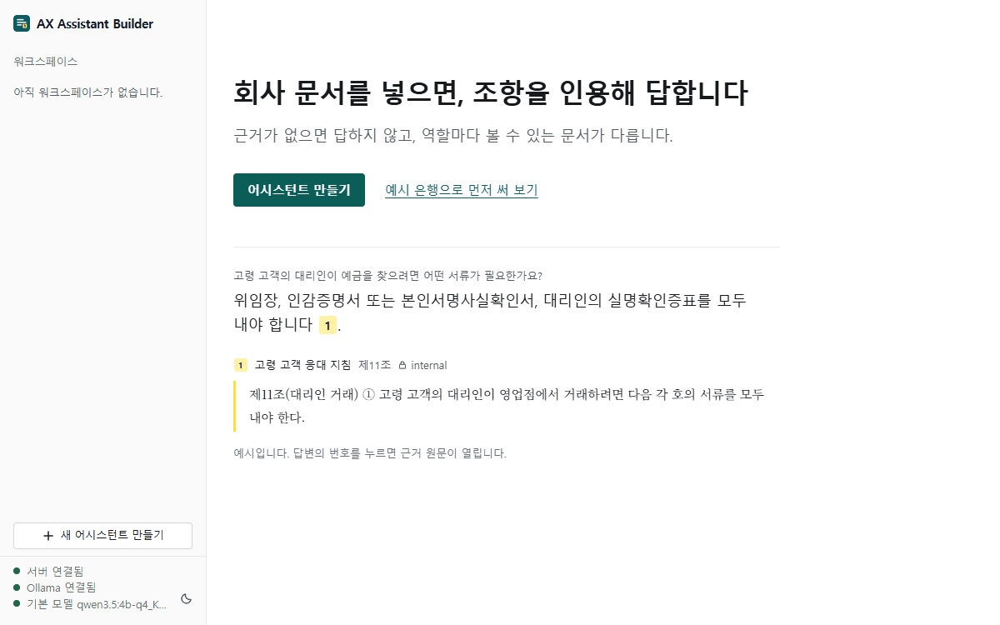
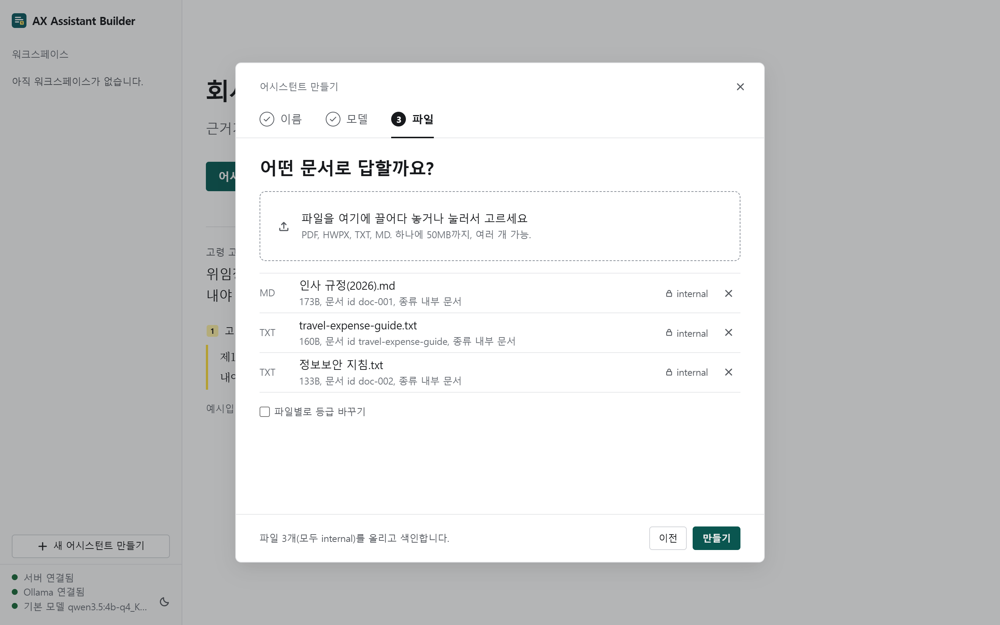
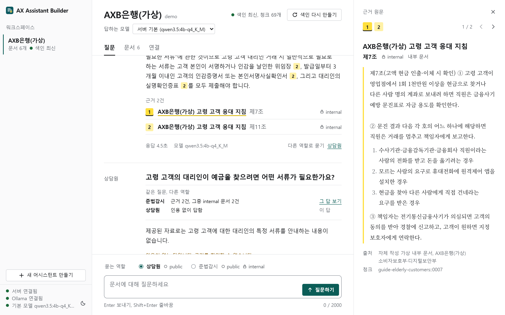
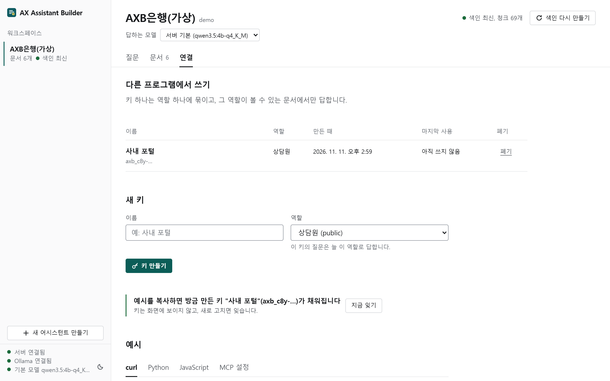
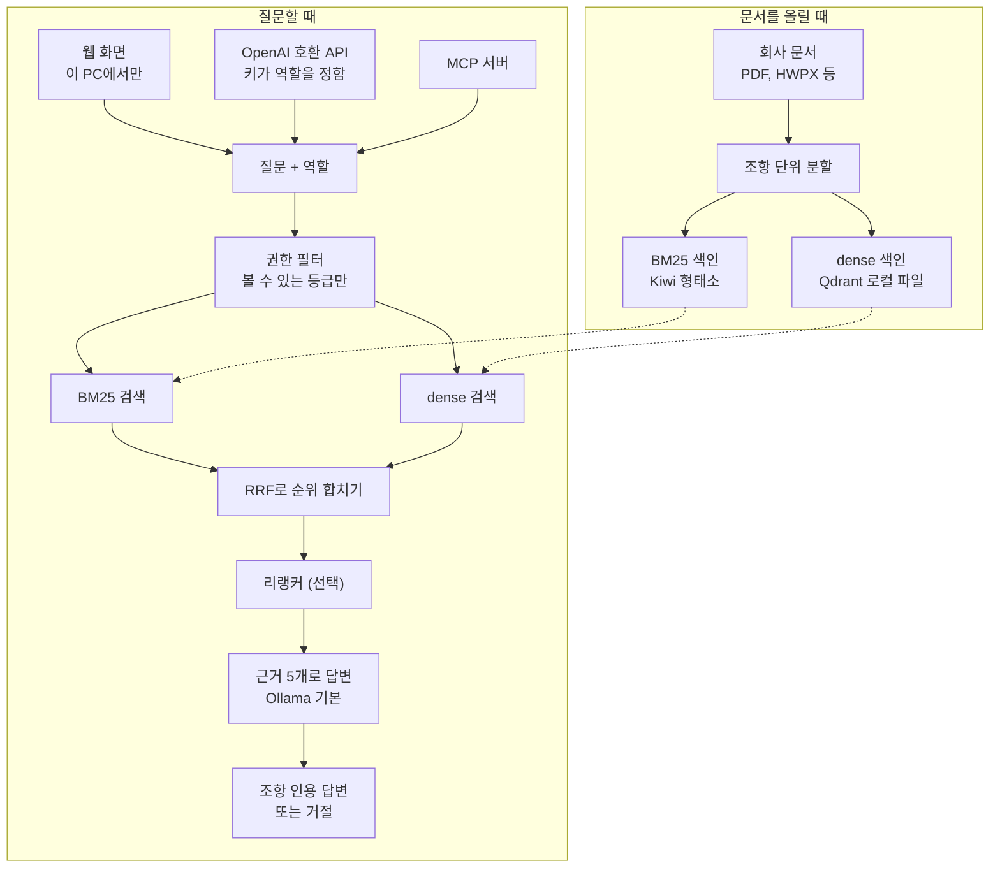

# AX Assistant Builder

**회사 문서를 올리면 그 문서를 근거로 답하는 회사 전용 어시스턴트를 만들어 주는 도구입니다.** 답에는 근거 조항을 달고, 문서에서 근거를 찾지 못하면 답하지 않도록 했습니다. 로컬 모델만으로도 동작합니다.

[](https://github.com/Growcompany/ax-assistant-builder/actions/workflows/ci.yml)
[](https://github.com/Growcompany/ax-assistant-builder/releases)




*35초짜리 데모입니다. 문서 3개로 어시스턴트를 만들어 질문한 뒤, 예시 은행에서 같은 질문을 `준법감시`와 `상담원` 역할로 각각 물어 답이 어떻게 달라지는지 보여 줍니다. 2026-11-11에 `axb serve`와 로컬 모델 `qwen3.5:4b-q4_K_M`으로 실제 실행한 화면을 장면별로 이어 붙였고, 답을 기다리는 시간은 잘라 냈습니다.*

## 소개

회사가 가진 규정, 약관, 상품설명서 같은 문서로 질문에 답하는 RAG 어시스턴트를 만들어 주는 프로젝트입니다. 회사마다 워크스페이스를 따로 두고, 문서에는 열람 등급을, 직원 역할에는 볼 수 있는 등급을 정합니다. 대표 사례로 실제 법령·약관과 이 프로젝트용으로 새로 쓴 가상 문서를 모아 가상 은행 워크스페이스를 만들었습니다.

- **문서만 올리면 전용 어시스턴트**: 회사 문서(PDF, HWPX, TXT, MD)를 올리면 그 문서를 근거로 답하는 어시스턴트가 만들어집니다. 답변에는 근거 조항이 번호로 표시되고, 문서에서 근거를 찾지 못하면 정해진 문구로 답을 거절하도록 만들었습니다([한계](#거절-판정)).
- **역할마다 다른 권한**: 문서마다 등급이 있고, 역할마다 볼 수 있는 등급이 다릅니다. 권한 밖 문서는 검색 단계에서 빠지기 때문에 같은 질문이라도 역할에 따라 답이 달라집니다.
- **기본 설정은 내 PC 안에서 동작**: 검색, 임베딩, 답변 생성이 모두 내 PC에서 실행되어 문서와 질문이 외부 API로 나가지 않습니다. 설정을 바꾸면 답변 생성에 Claude API를 쓸 수도 있습니다. 다만 외부 호출이 없다는 것을 아직 자동 테스트로 확인하지는 않았습니다([한계](#운영)).
- **다른 서비스와 연동**: 만든 어시스턴트는 OpenAI 호환 API와 MCP 서버를 통해 다른 프로그램에서도 쓸 수 있습니다. API 키마다 역할이 정해져 있어서, 키로 들어온 요청은 그 역할이 볼 수 있는 문서로만 답합니다.

가상 은행 문서 13개로 평가 질문 150개를 만들었고, 이 가운데 문서에 답이 있는 127문항으로 검색 성능을 측정했습니다. 기본 검색에 리랭커(검색 결과의 순위를 다시 매기는 모델)를 붙이면, 정답이 든 문서 조각이 상위 5개 안에 들어오는 비율(Recall@5)이 0.87에서 0.94로 올랐습니다. 다만 계획에서 정한 여러 비교를 함께 보정하면 이 차이는 통계적으로 유의하지 않습니다. 평가 질문은 AI 에이전트가 만들고 다른 에이전트가 원문과 대조했으며, 사람이 검수하지는 않았습니다. 정확한 값과 조건은 [평가 결과](#평가-결과)에 정리했습니다.

학사 졸업 후 AI/AX 엔지니어 직무에 지원하려고 만들고 있는 포트폴리오 프로젝트입니다.

## 화면


*`준법감시` 역할로 질문한 화면입니다. 답변이 내부 지침 제11조를 번호로 인용하고, 인용을 누르면 오른쪽에 근거 원문이 열립니다. 실제 서버와 로컬 모델 `qwen3.5:4b-q4_K_M`으로 캡처했습니다.*

<table>
  <tr>
    <td width="33%"></td>
    <td width="33%"></td>
    <td width="33%"></td>
  </tr>
  <tr>
    <td><b>만들기 3단계</b><br>이름, 모델, 파일을 차례로 정합니다. 이름이 한글인 파일도 올릴 수 있고, "만들기"를 누르면 업로드와 색인까지 진행됩니다. 데모의 문서 3개로는 실제로 25.7초가 걸렸고, GIF에서는 이 시간을 줄였습니다.</td>
    <td><b>같은 질문, 다른 역할</b><br><code>준법감시</code>는 내부 지침 두 조항을 인용해 답하고, <code>상담원</code>은 그 지침이 검색되지 않아 "자료에 없다"고 답합니다. 4B 모델은 실행마다 답이 조금씩 다르고, 이런 거절 답에 관련 없는 공개 문서를 인용으로 붙일 때도 있습니다(<a href="#모델">한계</a>).</td>
    <td><b>연결 탭</b><br>역할을 정해 API 키를 만들고, curl, Python, JavaScript, MCP 호출 예시를 복사해 쓸 수 있습니다.</td>
  </tr>
</table>

## 빠른 시작

```bash
git clone https://github.com/Growcompany/ax-assistant-builder.git
cd ax-assistant-builder
python -m venv .venv
source .venv/bin/activate              # Windows Git Bash: source .venv/Scripts/activate
pip install -e ".[dev]"

# 임베딩(색인·질문에 필요): 환경에 맞는 PyTorch를 먼저 설치한다 (https://pytorch.org)
pip install torch==2.15.0 --index-url https://download.pytorch.org/whl/cu132   # 확인한 환경(Windows, CUDA)의 명령
pip install -e ".[ml]"

# 로컬 LLM: Ollama를 설치하고(https://ollama.com) 기본 모델을 받는다
ollama pull qwen3.5:4b-q4_K_M

axb serve                              # 서버를 띄우고 브라우저를 연다
```

`axb serve`를 실행하면 처음에 아래 세 줄이 나오고, 그 뒤로 uvicorn 로그가 이어집니다. 2026-11-11에 실제로 실행한 출력입니다.

```text
Ollama: 연결됨
기본 모델: qwen3.5:4b-q4_K_M (설치됨)
화면: http://127.0.0.1:8000  (끝내려면 Ctrl+C)
```

v0.3.0부터는 `화면:` 줄 앞에 리랭커 상태가 한 줄 더 나오며, 기본값은 `리랭커: 꺼짐`입니다. 긴 조항 나누기를 켰다면 그 뒤에 `청크 분할: …` 줄도 나옵니다.

브라우저가 열리면 둘 중 하나를 고릅니다.

- **어시스턴트 만들기**: 이름, 모델, 파일을 차례로 정하면 워크스페이스 생성, 업로드, 색인이 순서대로 진행됩니다.
- **예시 은행으로 먼저 써 보기**: 저장소에 있는 가상 은행 문서 6개를 등록합니다. 색인을 만든 뒤 `상담원`과 `준법감시` 역할로 같은 질문을 해 보면 답이 어떻게 다른지 볼 수 있습니다.

리랭커와 긴 조항 나누기는 선택 기능이라 기본으로 꺼져 있고, 환경 변수로 켭니다. GPU가 있다면 리랭커를 켜는 것을 권장합니다.

```bash
AXB_RERANKER=kure-nano axb serve       # 리랭커 (.[ml] 필요, 첫 질문 때 모델 0.6GB 다운로드)
AXB_MAX_CHUNK_CHARS=800 axb serve      # 긴 조항 나누기 (값을 바꾸면 다시 색인 필요)
```

<details>
<summary>설치할 때 주의할 점 (Windows, torch 설치 순서, 모델 크기, 옵션)</summary>

- **확인한 환경**: Windows 11 + Git Bash, Python 3.13, RTX 3070 Ti 8GB에서 확인했습니다. `pyproject.toml`에 적힌 조건은 Python 3.11 이상입니다. CI(GitHub Actions, Ubuntu)에서는 `.[dev]`만 설치해 ruff 검사와 단위 테스트를 실행합니다.
- **가상환경 활성화**: Windows PowerShell에서는 `.venv\Scripts\Activate.ps1`을 실행합니다.
- **torch를 먼저 설치**: torch 없이 `.[ml]`부터 설치하면 pip가 PyPI에서 torch를 받는데, Windows에서는 이때 CPU 전용 버전이 설치됩니다.
- **임베딩 모델**: 첫 색인 때 `dragonkue/snowflake-arctic-embed-l-v2.0-ko`(Hugging Face 캐시 기준 약 2.2GB)를 내려받습니다.
- **Ollama**: 꺼져 있어도 서버는 뜹니다. 이때는 시작 메시지와 화면에서 해야 할 일(`ollama serve`, `ollama pull <모델>`)을 안내합니다. 모델 내려받기는 서버가 대신하지 않습니다.
- **`axb serve` 옵션**: `--port`(기본 8000), `--host`(기본 127.0.0.1), `--no-browser`, `--data-dir`(기본값은 `AXB_DATA_DIR`, 없으면 `data`). 실행 파일 없이 `python -m axbuilder.cli serve`로도 실행할 수 있고, `uvicorn axbuilder.api.main:app`으로 직접 띄울 수도 있습니다. 직접 띄울 때의 주의점은 [ADR 0005](docs/adr/0005-integration-surface.md#운영-경고)에 있습니다.
- **리랭커**: `AXB_RERANKER=kure-nano axb serve`로 켜며, `.[ml]`이 필요합니다. 평가 질문(골든셋 v1)에서는 세 검색기 모두 리랭커를 켰을 때 맞힌 문항이 늘었습니다([평가 결과](#평가-결과)). 기본으로 켜지 않는 이유는 정확도가 아니라 비용입니다.
  - 모델(`nlpai-lab/KURE-Reranker-nano`, 0.6GB)은 서버를 띄울 때가 아니라 처음 질문할 때 내려받아 메모리에 올리므로 첫 질문이 느립니다. 2026-11-12에 예시 은행으로 측정했을 때 첫 질문은 21.6초, 이후 질문은 1.8~2.2초가 걸렸습니다.
  - 질문당 검색 시간은 hybrid 기준 평균 42 ms에서 400 ms로 늘어납니다.
  - 8GB GPU에서는 Ollama와 임베딩 모델만으로도 VRAM이 거의 가득 찹니다. 답변 평가에서 VRAM 최대 사용량은 리랭커를 켰을 때와 껐을 때 모두 7,740~7,873 MiB였습니다. GPU 없는 PC에서는 측정하지 않았습니다.
  - 값은 `none`, `kure-nano`, `bge-v2-m3`만 받습니다. 그 밖의 값(예: `best`)을 주면 `설정 오류: …` 한 줄을 출력하고 종료 코드 2로 끝납니다. 리랭커를 불러오지 못하면 리랭커 없이 조용히 답하는 대신 질문에 503 오류를 돌려줍니다.
  - 비용 측정의 출처는 [한계](#운영)에, 결정 과정은 [ADR 0006](docs/adr/0006-reranker.md)에 있습니다.
- **긴 조항 나누기**: `AXB_MAX_CHUNK_CHARS=800 axb serve`로 켭니다. 800자보다 긴 본문 조항을 항·호·목 경계에서 나눕니다. 값을 바꾸면 이미 만든 색인이 "다시 색인 필요" 상태가 되고, 다시 색인할 때까지 질문에는 409를 돌려줍니다. 골든셋 v1에서 리랭커와 함께 켰을 때는 성능이 떨어지지 않았지만, 리랭커 없이 켜면 답이 든 조각의 순위가 조금 내려갔습니다. 결정 과정은 [ADR 0007](docs/adr/0007-article-split.md)에 있습니다.
- **환경 변수**: [`.env.example`](.env.example)에 `AXB_*` 전체와 기본값이 있습니다. 코드는 `.env` 파일을 읽지 않고 환경 변수만 봅니다.
- **pip 미러**: 이 저장소를 만든 PC에는 시스템 pip 설정에 응답하지 않는 미러가 들어 있어서 `PIP_CONFIG_FILE=nul pip install …`로 설정 파일을 무시했습니다. 보통은 필요 없습니다.

</details>

## 주요 기능

| 기능 | 설명 |
|---|---|
| 조항 단위 분할 | "제N조"가 두 번 이상 나오는 문서는 조항 단위로 나누고, 그렇지 않은 문서는 800자씩 나눕니다. |
| 긴 조항 나누기 (선택) | 800자보다 긴 본문 조항을 항, 호, 목, 줄 경계에서 다시 나눕니다. 둘째 조각부터 조항 제목(`제11조(대리인 거래)`)를 붙이고 조항 라벨은 그대로 두므로, 인용 표시가 달라지지 않습니다. |
| 하이브리드 검색 | 키워드 검색(Kiwi 형태소 분석 + 직접 구현한 BM25)과 의미 검색(한국어 dense 임베딩)의 순위를 RRF(k = 60)로 합칩니다. |
| 리랭커 (선택) | 검색기가 고른 후보 30개의 순위를 크로스 인코더로 다시 매겨 상위 5개를 씁니다. 권한 필터를 통과한 후보만 리랭커에 들어갑니다. |
| 문서 등급별 권한 | 역할마다 볼 수 있는 문서 등급을 정합니다. 검색 단계에서 걸러 내므로 권한 밖 문서는 LLM 프롬프트에 들어가지 않습니다. |
| 번호 인용과 근거 원문 | 답변의 `[n]`이 문서와 조항을 가리킵니다. 화면에서 누르면 그 질문에서 검색된 청크 원문이 열립니다. |
| 근거가 없으면 거절 | 검색된 근거 청크 5개만 보고 답하게 하고, 근거가 없으면 정해진 문구(`제공된 자료로는 확인할 수 없습니다.`)로 답하게 합니다. |
| 거절 판정 | 모델이 정해진 문구 대신 다른 말로 "자료에 없다"고만 답해도 거절로 보고 정해진 문구로 바꿉니다. 일부라도 답했다면 거절로 보지 않지만, 정해진 문구로 시작하는 답은 뒤에 내용이 있어도 거절로 처리합니다. 규칙으로 판정하므로 LLM을 한 번 더 부르지 않습니다. |
| 워크스페이스별 모델 선택 | Ollama에 설치된 모델 중에서 고릅니다. 응답의 `model` 값이 실제로 답한 모델입니다. |
| 빠른 만들기 | 화면에서 워크스페이스 생성, 업로드, 색인 API를 차례로 호출합니다. 문서의 기본 등급은 볼 수 있는 역할이 더 적은 `internal`입니다. |
| OpenAI 호환 API | `/v1/chat/completions`를 제공하므로 기존 클라이언트에서 `base_url`만 바꾸면 됩니다. 워크스페이스와 역할은 키가 정하고, 요청에서 역할을 고를 수 없습니다. |
| MCP 서버 | `axb mcp`(stdio)로 `list_workspaces`와 `ask` 도구를 제공합니다. `--workspace`와 `--role`로 워크스페이스와 역할을 고정할 수 있습니다. |
| 평가 CLI | 골든셋으로 Recall@k, MRR, 인용 정밀도, 거절 정확도를 측정해 보고서 JSON으로 남깁니다. 답 문구 기준 지표와 문항 태그별 결과도 함께 내고, 리랭커(`--reranker`, `--candidates`)와 분할(`--max-chunk-chars`) 조합도 같은 명령으로 비교합니다. |

버전별로 추가된 기능은 다음과 같습니다.

| 버전 | 추가된 것 |
|---|---|
| v0.1.0 | 검색, 인용 답변, 평가, REST API |
| v0.2.0 | 웹 화면, 모델 선택, API 키, OpenAI 호환 API, MCP, 릴리스 뒤 보안 보강. 검색 평가를 다시 돌린 수치는 v0.1.0과 같습니다. |
| v0.3.0 | 골든셋 전수 대조와 골든셋 v1(150문항), 답 문구 기준 채점, 다른 말로 한 거절까지 알아보는 판정, 리랭커와 긴 조항 나누기. 두 선택 기능을 켜지 않으면 검색 동작은 v0.2.0과 같습니다. 거절 판정의 기본 동작은 달라져서, 모델이 다른 말로 거절해도 정해진 문구로 바꾸고 인용을 붙이지 않습니다. |

M-1~M-6은 [설계 문서](docs/superpowers/specs/2026-11-09-company-assistant-builder-design.md)에서 나눈 개발 단계입니다. v0.3.0의 작업 범위는 [M-2 축소판](docs/superpowers/plans/2026-11-11-m2-slim.md)과 [M-2 마무리](docs/superpowers/plans/2026-11-12-m2-rest.md) 계획에 있습니다.

## 다른 서비스에서 사용하기

**1. API 키 만들기.** 화면의 **연결** 탭에서 역할을 골라 키를 발급합니다. 키 원문(`axb_`로 시작)은 발급할 때 한 번만 보여 주고, 서버에는 SHA-256 해시만 저장합니다. 키 하나는 워크스페이스 하나, 역할 하나와 연결됩니다.

**2. curl로 호출하기.** `model`에는 워크스페이스 id를 넣습니다. 아래 예시는 예시 은행 `demo`입니다.

```bash
curl http://127.0.0.1:8000/v1/chat/completions \
  -H "Authorization: Bearer axb_..." \
  -H "Content-Type: application/json" \
  -d '{"model": "demo", "messages": [{"role": "user", "content": "고령 고객의 대리인이 예금을 찾으려면 어떤 서류가 필요한가요?"}]}'
```

**3. Python `openai` SDK로 호출하기.** `base_url`만 바꾸면 됩니다. `openai` 패키지는 따로 설치해야 합니다.

```python
from openai import OpenAI

client = OpenAI(base_url="http://127.0.0.1:8000/v1", api_key="axb_...")
reply = client.chat.completions.create(
    model="demo",
    messages=[
        {"role": "user", "content": "고령 고객의 대리인이 예금을 찾으려면 어떤 서류가 필요한가요?"}
    ],
)
print(reply.choices[0].message.content)
```

답변 본문 끝에는 `출처` 목록이 텍스트로 붙습니다. 구조화된 값은 응답의 확장 필드 `axb`에 있습니다. `refused`는 거절 여부, `citations`는 인용, `passages`는 인용한 원문이고, `model`과 `latency_ms`도 함께 들어 있습니다. OpenAI 형식이 필요 없다면 `POST /v1/ask`에 `{"question": "…"}`만 보내도 됩니다.

**4. MCP로 연결하기.** 먼저 `pip install -e ".[mcp]"`로 MCP 패키지를 설치하고, Claude Desktop 같은 MCP 클라이언트 설정에 아래 내용을 추가합니다.

```json
{
  "mcpServers": {
    "axb-demo": {
      "command": "axb",
      "args": ["mcp", "--data-dir", "<데이터 폴더의 절대 경로>", "--workspace", "demo", "--role", "상담원"]
    }
  }
}
```

`--workspace`와 `--role`을 지정하면 그 값으로 고정되어, 도구가 워크스페이스나 역할을 인자로 받지 않습니다. `axb mcp`는 API 키를 쓰지 않습니다. 이 명령을 실행할 수 있다면 이미 이 PC의 데이터에 접근할 수 있기 때문입니다.

### 접근 범위

| 경로 | 사용할 수 있는 곳 | 조건 |
|---|---|---|
| 화면, 관리 API (워크스페이스, 업로드, 색인, 키 발급, `/workspaces/{id}/ask`) | 이 PC | 밖에서 오면 유효한 키가 있어도 403을 돌려줍니다. |
| `/v1/*` | 어디서든 | 키가 없거나 틀리면 401입니다. 이 PC에서 호출해도 키가 필요합니다. |
| `axb mcp` | 이 PC (직접 실행) | 키 없이 stdio로 연결합니다. |

- **다른 PC에서 쓰려면** `AXB_ALLOWED_HOSTS=127.0.0.1,localhost,<이 PC의 IP 또는 이름> axb serve --host 0.0.0.0`으로 실행합니다. 이때도 밖에서는 키로 `/v1/*`만 쓸 수 있습니다.
- **평문 HTTP입니다.** 이렇게 열면 키, 질문, 답변이 암호화되지 않은 채 네트워크로 오가고, 답변에는 내부 문서 발췌도 들어 있습니다.
- **API 문서 화면(`/docs`, `/redoc`)은 기본으로 꺼져 있습니다.** `AXB_API_DOCS=true`로 켤 수 있지만, 켜면 외부 CDN의 스크립트를 불러오고 화면의 버튼으로 관리 API가 실행되므로 개발할 때만 켜야 합니다. `/openapi.json`은 이 설정과 관계없이 켜져 있지만, 다른 관리 경로처럼 이 PC에서만 열 수 있습니다.
- **"이 PC에서 온 요청"인지 확인하는 것은 인증이 아닙니다.** 프록시, SSH 터널, 포트 전달을 거친 요청도 이 PC에서 온 것으로 보입니다. 프록시 뒤에 두거나 `uvicorn`으로 직접 실행하기 전에 [ADR 0005의 운영 경고](docs/adr/0005-integration-surface.md#운영-경고)를 먼저 읽어야 합니다.

<details>
<summary>전체 경로 표</summary>

| 메서드 | 경로 | 하는 일 |
|---|---|---|
| GET | `/`, `/static/…` | 화면 파일을 제공합니다. CSP와 nosniff 헤더를 붙입니다. |
| GET | `/health` | 서버가 떠 있는지 확인합니다(`{"status": "ok"}`). 모델을 불러오지 않습니다. |
| GET | `/models` | Ollama에 설치된 모델 목록을 돌려줍니다. |
| GET | `/workspaces`, `/workspaces/{id}` | 워크스페이스 목록과 상세 정보(문서 목록, 색인 상태)를 돌려줍니다. |
| POST | `/workspaces` | 워크스페이스(이름, 역할별 문서 등급)를 만듭니다. 같은 id가 있으면 409입니다. |
| PATCH | `/workspaces/{id}` | 답변에 쓰는 모델(`llm_model`)을 바꿉니다. |
| POST | `/demo-workspace` | 가상 은행 문서 6개로 워크스페이스 `demo`를 만듭니다. 색인은 하지 않습니다. |
| POST | `/workspaces/{id}/documents` | 문서를 올립니다. PDF, HWPX, TXT, MD를 50MB까지 받고, `access_level`은 필수입니다. |
| POST | `/workspaces/{id}/index` | BM25와 dense 색인을 만듭니다. |
| POST | `/workspaces/{id}/ask` | `{"question", "role"}`을 받아 `{"answer", "citations", "passages", "refused", "model", "latency_ms"}`를 돌려줍니다. |
| POST · GET | `/workspaces/{id}/keys` | 키를 발급하거나(201, 원문은 이 응답에만 있음) 목록을 돌려줍니다. |
| DELETE | `/workspaces/{id}/keys/{key_id}` | 키를 폐기합니다(204). |
| GET | `/v1/models` | 그 키의 워크스페이스 하나를 돌려줍니다. |
| POST | `/v1/chat/completions` | OpenAI chat.completion 형식으로 답합니다. `stream=true`면 SSE로 보내고, `model`이 키의 워크스페이스 id가 아니면 404입니다. |
| POST | `/v1/ask` | `{"question"}`을 받아 `/workspaces/{id}/ask`와 같은 형식으로 답합니다. |

`/v1/*`의 오류는 OpenAI 형식(`{"error": {message, type, code, param}}`)으로 돌려줍니다.

</details>

## 구조



| 단계 | 구현 | 위치 |
|---|---|---|
| 파싱·분할 | PDF(pdfplumber), HWPX(표준 라이브러리 XML), 법령 HTML을 읽습니다. "제N조"가 두 번 이상 나오면 조항 단위로, 아니면 800자 단위로 나누고, 켜면 긴 본문 조항을 항·호·목 경계에서 더 나눕니다(`AXB_MAX_CHUNK_CHARS`). | `src/axbuilder/ingest/` |
| 검색 | BM25와 RRF는 직접 구현했고, dense는 `dragonkue/snowflake-arctic-embed-l-v2.0-ko`와 Qdrant 로컬 모드를 씁니다. 리랭커(`rerank.py`)는 켰을 때만 검색기를 감쌉니다. | `src/axbuilder/retrieval/` |
| 생성 | 근거 청크 5개만 보고 답하게 하는 프롬프트를 씁니다. 인용 번호를 다시 매기고 범위 밖 번호는 지웁니다. 답이 정해진 문구로 시작하거나 답 전체가 바꿔 말한 거절이면(`refusal.py`) 거절로 처리합니다. | `src/axbuilder/generation/` |
| 평가 | 골든셋의 태그와 답 문구를 검증합니다. 그다음 Recall@k·MRR(라벨 기준과 답 문구 기준), 인용 정밀도, 거절 정확도(기존 정의와 근거 기준), 태그별 요약을 계산해 보고서 JSON으로 남깁니다. | `src/axbuilder/eval/` |
| 관리 API | 워크스페이스, 업로드, 색인, 질문, 모델 목록과 선택을 처리합니다. 업로드할 때 파일 이름, 크기, 형식 서명을 검사합니다. HWPX는 압축 해제량에 상한을 두고 DTD를 거부하며, PDF는 해제량과 쪽당 객체 수에 상한을 둡니다. PDF 파싱의 CPU 시간은 아직 제한하지 못합니다([한계](#보안)). | `src/axbuilder/api/app.py` |
| 화면 | 사이드바(워크스페이스 목록), 질문·문서·연결 탭, 근거 패널, 만들기 대화상자로 이루어집니다. 서버에서 받은 문자열은 HTML로 해석되지 않도록 텍스트 노드로만 넣습니다. | `src/axbuilder/api/static/` |
| 외부 연결 | API 키(`keys.py`), OpenAI 호환 `/v1`(`v1.py`), MCP 서버(`mcp_server.py`)로 이루어집니다. | `src/axbuilder/api/`, `src/axbuilder/mcp_server.py` |
| 접근 규칙 | `/v1/*`는 API 키로 인증하고, 그 밖의 경로는 이 PC(loopback)에서 온 요청만 받습니다. Host 허용 목록, 다른 출처 요청 거절, 본문 크기 상한도 여기서 처리합니다. | `src/axbuilder/api/access.py`, `app.py` |
| 실행 | `axb serve`, `axb mcp`, `axb --version` 명령을 제공합니다. | `src/axbuilder/cli.py` |

## 기술 스택

표의 "직접 구현"은 라이브러리 기능을 가져다 쓰지 않고 이 저장소에서 코드로 작성한 부분입니다.

| 영역 | 사용한 것 | 구분 | 선택 이유와 방식 |
|---|---|---|---|
| 언어·런타임 | Python 3.11 이상(확인은 3.13), pydantic 2 | 라이브러리 | 설정, 요청, 저장 파일을 모델로 검증합니다. |
| API | FastAPI, uvicorn | 라이브러리 | 서버 하나가 화면, 관리 API, `/v1`을 모두 제공합니다. |
| 화면 | HTML 하나, CSS 하나, ES 모듈 JS. 빌드 도구와 프레임워크 없음 | **직접 구현** | 폐쇄망에서도 외부 요청 없이 떠야 합니다. 서버에서 받은 문자열은 텍스트 노드로만 넣고(XSS 방지) CSP 헤더를 붙입니다. → [ADR 0004](docs/adr/0004-web-ui-static.md) |
| 형태소 분석 | Kiwi(`kiwipiepy` 0.24) | 라이브러리 | BM25 토큰을 공백이 아니라 형태소 단위로 자릅니다. |
| 키워드 검색 | BM25 | **직접 구현** | 점수 계산과 색인을 직접 작성했습니다. → [Task 1 학습 노트](docs/learning/task-01-bm25.md) |
| 의미 검색 | `dragonkue/snowflake-arctic-embed-l-v2.0-ko`(sentence-transformers), Qdrant 로컬 모드 | 라이브러리 | 별도 서버 없이 워크스페이스 폴더 안의 파일로 색인합니다. |
| 순위 융합 | RRF(k = 60, 검색기마다 후보 30개) | **직접 구현** | 점수 척도가 다른 두 검색기를 순위만으로 합칩니다. → [ADR 0002](docs/adr/0002-hybrid-rrf.md) |
| 리랭커 (선택) | `nlpai-lab/KURE-Reranker-nano`(권장), `BAAI/bge-reranker-v2-m3`(비교 대상), sentence-transformers `CrossEncoder` | 모델과 채점은 라이브러리, 기존 검색기를 감싸는 `RerankRetriever`와, 길이 제한으로 잘린 입력을 세는 코드는 **직접 구현** | 기존 검색기를 고치지 않고 붙였다 뗄 수 있습니다. 처음 쓸 때 불러오므로 기본 설치는 리랭커 모델 없이 동작합니다. → [ADR 0006](docs/adr/0006-reranker.md) |
| 거절 판정 | 문장 단위 규칙(정규식) | **직접 구현** | 요청마다 실행되는 코드라 결과가 결정적이고 설명 가능해야 합니다. 정밀도를 우선합니다. → [Task 20 학습 노트](docs/learning/task-20-refusal-detection.md) |
| LLM | Ollama `qwen3.5:4b-q4_K_M`(기본), Claude로 전환 가능 | 프로토콜은 **직접 구현**, Claude 호출은 anthropic SDK | `generate(system, user)` 하나로 감쌌습니다. Claude 경로는 모의 테스트까지만 했습니다. → [ADR 0003](docs/adr/0003-llm-protocol-local-first.md) |
| 문서 파싱 | PDF는 pdfplumber, HWPX와 법령 HTML은 표준 라이브러리 | PDF는 라이브러리, HWPX·HTML은 **직접 구현** | HWPX는 ZIP 안의 XML에서 텍스트만 뽑고, 파싱 자원에 상한을 둡니다. |
| 청크 분할 | 조항 단위 분할, 긴 조항 나누기(선택) | **직접 구현** | 법령의 구조(조·항·호·목)를 경계로 삼아 조각마다 뜻이 온전히 담기게 합니다. 나누는 길이 800자는 두 리랭커의 토크나이저로 측정해서 골랐습니다. → [ADR 0007](docs/adr/0007-article-split.md), [Task 25 학습 노트](docs/learning/task-25-article-split.md) |
| 외부 연결 (HTTP) | OpenAI 호환 응답 형식, API 키(SHA-256 해시 저장) | **직접 구현** | 서버는 `openai` 패키지에 의존하지 않습니다. → [ADR 0005](docs/adr/0005-integration-surface.md) |
| 외부 연결 (MCP) | MCP SDK(`mcp>=2`, 선택 설치) | 라이브러리 | 기본 설치와 단위 테스트는 SDK 없이 동작합니다. |
| 평가 | Recall@k·MRR(라벨 기준, 답 문구 기준), 인용 정밀도, 거절 정확도(기존 정의, 근거 기준), 태그별 요약 | **직접 구현** | 라벨 기준은 상품설명서와 나눈 조각에서 점수를 후하게 주므로, 답이 든 청크만 맞게 세는 기준을 함께 둡니다. → [Task 24 학습 노트](docs/learning/task-24-golden-v1.md) |
| 품질 | pytest, ruff, GitHub Actions | 라이브러리 | 단위 테스트는 네트워크, GPU, 모델 없이 실행됩니다. 실제 모델 테스트는 `slow` 표시로 분리합니다. |

## 평가 결과

평가는 가상 은행 워크스페이스의 문서 13개(945청크)로 진행했습니다. 평가 질문인 골든셋 v1은 150문항이고, 이 중 근거가 있는 127문항으로 검색을 채점합니다. 문서에 답이 없는 질문(범위 밖) 23문항은 답변 평가에만 씁니다. 측정은 모두 `준법감시` 역할, 상위 5개(k = 5) 기준입니다.

아래 표는 **답 문구 기준**으로 채점한 값입니다. 근거 조항의 청크가 상위 5개에 드는 것만으로는 부족하고, 그 청크에 정답 문구까지 들어 있어야 맞힌 것으로 셉니다. 이렇게 엄격하게 세는 것은, 조항 라벨만 맞으면 정답으로 칠 경우 조항 번호가 없는 상품설명서나 긴 조항을 나눈 조각에서 답이 없는 청크도 정답이 되기 때문입니다.

| 검색기 | 리랭커 없음 (Recall@5 / MRR) | 리랭커 사용 (Recall@5 / MRR) | 리랭커로 새로 맞힘 / 새로 놓침 |
|---|---|---|---|
| BM25 | 0.827 / 0.665 | 0.909 / 0.853 | 15 / 2, p = 0.002 |
| dense | **0.886 / 0.810** | **0.948 / 0.880** | 10 / 2, p = 0.039 |
| hybrid (기본) | 0.870 / 0.752 | 0.941 / 0.866 | 12 / 2, p = 0.013 |

리랭커는 KURE-Reranker-nano를 썼고, 후보는 30개입니다. "맞힘"은 근거를 모두 찾은 문항이고, p는 문항 단위 정확 맥니마 검정의 보정 전 값입니다.

- **리랭커 효과는 보정하면 약해집니다.** 세 검색기 모두 리랭커를 켜면 맞힌 문항이 늘었고 보정 전 p는 0.05보다 작습니다. 리랭커 비교 3개만 한 묶음으로 Holm 보정해도 셋 다 유의합니다. 하지만 계획에서 정한 비교 11개(리랭커, 긴 조항 나누기, dense 대 hybrid)를 한 묶음으로 보정하면 BM25만 유의합니다.
- **dense와 hybrid는 차이가 없었습니다.** 리랭커가 없을 때는 한쪽만 맞힌 문항이 hybrid 8개, dense 10개로 비슷했습니다. 리랭커를 켜면 두 검색기가 맞힌 문항(117개)이 완전히 같았습니다. 기본값을 hybrid로 둔 것은 데이터가 뒷받침해서가 아닙니다. 바꿀 만큼 차이가 나지 않았고 사람이 검수한 표본도 없어서 그대로 두었습니다([ADR 0002](docs/adr/0002-hybrid-rrf.md#갱신-2026-11-12-골든셋-v1)).
- **답변 품질이 나아졌는지는 확실하지 않습니다.** 150문항에 조건마다 두 번씩 답하게 했더니, 리랭커를 켰을 때 거절 여부가 맞은 비율(근거 기준 거절 정확도)은 올랐지만 그 폭이 실행할 때마다 생기는 차이와 비슷했습니다. 인용 정밀도는 오르지 않았고, 이전 50문항 실험에서 본 0.670 → 0.827은 재현되지 않았습니다.
- **권한 확인에서 내부 문서는 한 번도 나오지 않았습니다.** 공개 문서만 볼 수 있는 `상담원` 역할로 150문항에 답하게 했을 때 검색 결과와 인용에 내부 문서가 없었고, 내부 지침에만 있는 낱말 10개 중 어느 것도 답변에 나오지 않았습니다.
- **골든셋과 답변 판정은 사람이 검수하지 않았습니다.** 골든셋은 AI 에이전트가 만들고 다른 에이전트가 원문과 전수 대조했으며, 이 판단은 제가 에이전트에게 맡겼습니다. 답변 판정과 분류도 평가 담당 에이전트가 출력을 읽고 했습니다. 또 같은 127문항으로 검색 조합 24개를 비교했으므로, 가장 좋게 나온 값은 실제보다 높게 나왔을 수 있습니다.

라벨 기준 수치, 답변 지표 표, 긴 조항 나누기 비교, 실행 시간, 이전 실험(M-1 기준선, M-2 축소판)과 재현 명령은 [실험 기록 모음](docs/experiments/README.md)에 있습니다.

## 설계 결정

결정마다 맥락과 대안은 링크한 ADR과 학습 노트에 있습니다.

1. **회사(워크스페이스)마다 데이터를 폴더째 분리합니다.** 컬렉션 하나에 회사 id 필터를 거는 방식은 필터를 한 번만 빠뜨려도 다른 회사 문서가 섞이기 때문입니다. → [ADR 0001](docs/adr/0001-workspace-isolation.md)
2. **검색 코어(BM25, RRF)는 직접 구현하고, BM25와 dense를 RRF로 합칩니다.** 다만 첫 실험에서는 dense 단독이 더 좋았고 골든셋 v1에서도 차이가 없어서, 기본값 hybrid는 잠정 결정입니다. 사람이 검수한 표본에서도 같은 결과가 나오면 dense 계열로 바꿀 계획입니다. → [ADR 0002](docs/adr/0002-hybrid-rrf.md)
3. **LLM 호출은 `generate(system, user)` 프로토콜 하나로 추상화하고, 기본값은 로컬 모델(Ollama, qwen3.5 4B)입니다.** 폐쇄망 고객을 기본으로 가정했고, 테스트는 가짜 LLM으로 네트워크 없이 실행됩니다. → [ADR 0003](docs/adr/0003-llm-protocol-local-first.md)
4. **권한은 답변 생성이 아니라 검색 단계에서 거르고, 근거가 없으면 정해진 문구로 거절하게 합니다.** 권한 밖 문서는 LLM 프롬프트에 아예 들어가지 않습니다. → [Task 7 학습 노트](docs/learning/task-07-answer.md)
5. **골든셋은 "정답 + 근거 위치(조항)"로 만들고, 검색과 답변을 따로 평가합니다.** 검색은 근거 위치로(Recall@k, MRR), 답변은 인용과 거절로 채점합니다. 골든셋 v1부터는 근거마다 답 문구를 달아, 답이 든 청크만 맞게 세는 기준을 함께 봅니다. → [Task 8](docs/learning/task-08-golden-dataset.md)·[Task 9](docs/learning/task-09-eval-runner.md)·[Task 24](docs/learning/task-24-golden-v1.md) 학습 노트
6. **화면은 Streamlit 대신 빌드 과정 없는 정적 파일로 만들고, FastAPI가 직접 제공합니다.** 프로세스와 의존성이 늘지 않고 외부 요청 없이 뜹니다. 대신 상태 관리를 직접 작성해야 하고 프런트엔드 단위 테스트가 없습니다. 설계 문서는 화면을 일정 마지막(M-6)에 두었지만, 이 결정으로 앞당겼습니다. → [ADR 0004](docs/adr/0004-web-ui-static.md)
7. **외부 연동은 OpenAI 호환 API와 MCP로 제공하고, API 키마다 역할 하나를 정하며, 관리 기능은 이 PC에서만 씁니다.** 요청이 역할을 직접 고르게 하면 누구나 높은 역할을 고를 수 있기 때문에, 키로 들어온 요청은 역할을 고를 수 없게 했습니다. → [ADR 0005](docs/adr/0005-integration-surface.md)
8. **리랭커는 선택 기능으로 두고 기본은 끄되, GPU가 있으면 켜는 것을 권장합니다(KURE-Reranker-nano, 후보 30개).** 골든셋 v1에서 hybrid의 Recall@5(답 문구 기준)는 0.870에서 0.941로 올랐지만, 여러 비교를 함께 보정하면 유의하지 않습니다([평가 결과](#평가-결과)). 기본으로 켜지 않는 것은 정확도가 아니라 비용 때문입니다. 처음에 모델 0.6GB를 내려받아야 하고, 첫 질문이 느리며, 8GB GPU에서는 LLM과 메모리를 나눠 써야 합니다. GPU 없는 PC에서는 측정하지 않았습니다. 모델도 정확도가 아니라 비용을 보고 골랐습니다. → [ADR 0006](docs/adr/0006-reranker.md)
9. **긴 조항 나누기는 선택 기능으로 두고 기본은 끕니다(켤 때 800자).** 리랭커가 한 번에 읽는 길이(512토큰)를 넘어 뒷부분이 잘리는 입력은 10.0%에서 0.3%로 줄었지만, 새로 맞힌 문항은 하나(bank-042)뿐이었습니다. 리랭커 없이 켜면 답이 든 조각의 순위가 내려가고, 기본값을 바꾸면 이미 색인한 워크스페이스를 모두 다시 색인해야 합니다. → [ADR 0007](docs/adr/0007-article-split.md)

## 한계

### 평가

- **사람 검수가 없습니다.** 골든셋 v1 150문항은 에이전트가 만들고 다른 에이전트가 원문과 전수 대조했으며, 대조에서 새 문항 2개를 고쳤습니다. 2026-11-12에 제가 남은 판단을 에이전트에게 맡겼기 때문에 아래 항목도 에이전트가 정했습니다. 만든 쪽과 대조한 쪽이 같은 계열 모델이라 같은 오독을 공유할 수 있습니다.
  - 대조에서 애매하다고 표시된 10문항: 1문항은 질문을 고치고 9문항은 그대로 두었습니다.
  - 골든셋 v0의 [확인 목록](docs/eval/golden-v0-owner-check.md) 11문항
  - 거절 라벨 중 애매한 7개
- **정답 근거를 한 곳만 인정합니다.** 골든셋 형식에 "이것을 찾아도 정답"이라고 적는 칸이 없어서, 정답이 다른 문서나 조항에도 일부 나오는 문항(v0의 004·009, v1의 083·088·117)은 라벨이 붙은 한 곳만 정답으로 채점됩니다.
- **질문과 답 문구가 문서에 가깝습니다.** 답 문구는 근거마다 하나이고 만든 에이전트가 골랐습니다. 질문도 문서를 보고 만들어서, 새 문항 중 범위 밖을 뺀 83개 가운데 37개는 원문 한 문장을 바꿔 물은 질문입니다.
- **역할은 둘만 썼습니다.** 검색과 답변은 `준법감시`로, 권한 확인은 `상담원`으로 한 번 측정했습니다([제작·대조 기록](docs/eval/golden-v1-build.md)).
- **지표가 측정하지 못하는 것이 있습니다.** 인용 정밀도는 인용 위치(라벨)만 봅니다. 그래서 맞는 조항을 인용하고 내용을 틀리게 옮긴 답은 잡지 못하고, 긴 조항 나누기를 켜면 답이 없는 조각을 인용해도 맞게 셉니다. 내용이 틀린 답은 미뤄 둔 답변 채점(LLM-judge와 사람 채점)으로 잡아야 합니다.

### 거절 판정

- **규칙 기반이라 놓치는 거절이 있습니다.** 저장해 둔 모델 출력 150개로 측정한 재현율은 0.732로, 거절 41개 중 11개를 놓쳤습니다. 규칙을 만들 때 보지 않은 출력 50개에서는 재현율이 0.538이었고, 그중 바꿔 말한 거절은 하나도 잡지 못했습니다.
- **놓친 거절은 답변으로 나갑니다.** "확인할 수 없습니다. [1], [2] …"처럼 인용이 달린 채 나가고, 응답의 `refused` 값도 `false`가 됩니다. 그래서 평가 지표의 "근거가 없는데 답함" 건수를 환각 건수로 읽으면 안 됩니다. 골든셋 v1을 여섯 번 실행해 이렇게 분류된 50건 가운데 47건은 판정기가 놓친 거절이었고, 실제로 근거 없이 답한 것은 3건뿐이었습니다.
- **반대로, 맞는 답이 거절로 바뀌기도 합니다.** 정해진 문구로 시작한 뒤 정답을 덧붙인 출력은 규칙대로 거절이 됩니다. 이때 `answer()`가 답변을 정해진 문구로 바꾸고 인용을 지우므로, 사용자는 그 답을 보지 못합니다. 골든셋 v1 답변 기록의 아홉 실행에서 5건이 나왔고, 그중 1건은 채택하지 않은 프롬프트 실험에서 나왔습니다.
- **오탐은 확인한 범위에서 없었습니다.** 범위 밖이 아닌 문항에서 바꿔 말한 거절로 판정된 실제 출력 21건을 읽어 보니, 부정문 정답을 거절로 본 경우는 없었습니다. 다만 "제공된 자료로는 X를 확인할 수 없습니다"가 정답인 경우는 거절 문구와 글자가 같아 거절로 판정합니다.
- **규칙은 지금의 모델과 프롬프트에 맞춰져 있습니다.** 이 모델(`qwen3.5:4b`)과 이 프롬프트의 합니다체 문구를 기준으로 만들었으므로, 모델을 바꾸면 라벨을 단 출력으로 다시 검증해야 합니다. 라벨과 판독은 에이전트가 했습니다([거절 라벨](docs/eval/refusal-labels.md), [답변 기록](docs/experiments/2026-11-12-answers-v1.md)).

### 모델

- **4B 로컬 모델은 표의 행을 잘못 읽기도 합니다.** 12개월 만기 정기예금의 기본금리를 묻자 "12개월"이 든 바로 위 행을 읽어 2.55%라고 답했습니다. 정답은 2.80%입니다([API 호출 기록](docs/experiments/README.md#평가-다시-실행하기)).
- **정해진 거절 문구를 지키지 않을 때가 있고, 그 거절에 관련 없는 인용을 달기도 합니다.** 판정기가 잡으면 정해진 문구로 바뀌고 인용이 빠지지만, 놓치면 그대로 나갑니다.
- **근거를 받고도 거절하는 과잉 거절이 있습니다.** 골든셋 v1의 여섯 실행에서 9~13건씩 나왔고, 특히 정답이 부정문인 문항에서 많았습니다. 시스템 프롬프트에 한 줄을 더해 줄여 봤지만, 모델이 정해진 거절 문구 대신 다른 말로 거절하는 부작용이 생겨 채택하지 않았습니다.
- **답이 실행마다 다릅니다.** 같은 조건으로 두 번 실행하면 150문항 중 14~24문항에서 거절 여부가 바뀝니다.

### 검색

- **기본 검색기(hybrid)는 잠정적인 선택입니다.** 골든셋 v1에서는 리랭커를 켜든 끄든 hybrid가 dense보다 높게 나온 경우가 없었습니다([ADR 0002](docs/adr/0002-hybrid-rrf.md#갱신-2026-11-12-골든셋-v1)).
- **리랭커 입력은 512토큰에서 잘립니다.** 기본 분할에서는 리랭커에 들어가는 (질문, 청크) 쌍의 10.0%가 길이 제한에 걸려, 청크 뒷부분이 순위 계산에 반영되지 않습니다. 긴 조항 나누기(800자)를 켜면 이 비율이 0.3%로 줄지만, 리랭커 없이 켜면 답 문구 기준 순위가 내려갑니다.
- **나눈 조각이 상위 자리를 나눠 차지하기도 합니다.** 800자로 나누면 같은 조항의 조각들이 상위 5개 안에 함께 들어오는 문항이 21~27개 생겼습니다. 이 조각들이 차지한 자리는 상위 5개 자리 전체의 4~6%입니다. 나눠도 답이 든 조각이 후보에 들지 못하는 문항(bank-005)은 그대로입니다.
- **부칙이 검색에 잡음이 됩니다.** 청크의 41%가 부칙이고, 긴 조항 나누기도 부칙에는 적용하지 않습니다. 가장 긴 본문 조항은 3,572자(전자금융거래법 제2조)입니다. 가장 긴 청크는 본문이 아니라 다른 법률 개정 지시문이 붙은 부칙 조항(금소법 부칙 제13조)으로, 11,452자입니다.
- **청크 길이에 상한이 없습니다.** 긴 조항 나누기를 켜지 않으면 조항 청크의 길이가 제한되지 않아, 답변 응답의 인용 원문(`passages[].text`)도 그만큼 길어질 수 있습니다. 서버는 자르지 않고, 화면에서 원문을 보여 줄 때만 길이를 제한합니다.

### 기능 범위

- **화면**: 대화는 브라우저 메모리에만 있어 새로 고치면 사라집니다. 문서 삭제와 역할 수정은 화면과 API 모두에 없습니다. 문서 기록 파일(`documents/{doc_id}.json`)이 깨지면 그 문서는 목록과 색인에서 빠지고 서버 로그에만 남습니다. 같은 id로 다시 올리면 409이므로, `data/workspaces/{id}/documents/`에서 그 id의 파일 두 개를 직접 지워야 합니다.
- **프런트엔드 테스트**: 자동 테스트가 없습니다. 위험한 API(`innerHTML` 등)와 깨진 파일 참조를 찾는 정적 검사, 화면이 쓰는 API의 파이썬 테스트, 브라우저 수동 확인으로 대신합니다. 그래서 화면이 예전처럼 동작하는지는 직접 눌러 봐야 알 수 있습니다([ADR 0004](docs/adr/0004-web-ui-static.md)).
- **OpenAI 호환 API**: OpenAI API의 일부만 지원합니다. `stream=true`는 토큰 단위가 아니라 완성된 답을 조각 하나로 보냅니다. 대화 이력과 system 메시지는 쓰지 않고 마지막 user 메시지만 질문으로 씁니다. `temperature`, `tools` 같은 필드는 읽지 않습니다.
- **API 키**: 사용량 제한, 틀린 키 시도 횟수 제한, 만료일이 없고, 워크스페이스당 키 100개 상한만 있습니다. 유효한 키로 LLM을 계속 부르는 것은 막지 못합니다([ADR 0005](docs/adr/0005-integration-surface.md)).
- **문서 형식**: API로 올릴 수 있는 형식은 PDF, HWPX, TXT, MD입니다. 법령 HTML은 다운로드 스크립트가 조문 텍스트로 바꿔 `.txt`로 저장하며, API 업로드로는 HTML을 받지 않습니다. DOCX와 XLSX는 아직 지원하지 않습니다. 시행일 메타데이터는 저장만 하고 검색에는 쓰지 않으며, 구버전 문서 처리도 아직 없습니다.

### 보안

- **사용자 계정이 없습니다.** `/v1/*`에서는 키가 역할을 정하지만, 관리 API(`/workspaces/{id}/ask` 포함)에서는 요청이 역할을 정합니다. 그래서 `/v1/*`가 아닌 경로는 이 PC(loopback)에서 온 요청만 받고, 밖에서 오면 403을 돌려줍니다.
- **이 PC에서 온 요청만 받는 것은 인증이 아닙니다.** 이 PC에서 실행되는 프로그램은 무엇이든 이 서버의 관리 기능을 쓸 수 있습니다. SSH 터널, 포트 전달, `X-Forwarded-For`를 붙이지 않는 같은 PC의 프록시를 거친 요청도 이 PC에서 온 것으로 보입니다. `--host 0.0.0.0`으로 열면 키와 답변이 평문 HTTP로 오갑니다.
- **기본이 아닌 실행 방식에서 접근 제한이 뚫린 적이 있습니다.** 독립 보안 리뷰에서, IPv6 loopback으로 접속하는 프록시를 쓰거나 `--root-path`로 띄우면 접근 제한이 뚫린다는 것을 재현했습니다. 두 문제는 고쳤고, 내용은 [ADR 0005의 운영 경고](docs/adr/0005-integration-surface.md#운영-경고)에 적어 두었습니다. v0.1.0에는 이 검사와 키가 없으므로, 그 버전은 127.0.0.1에만 띄워야 합니다.
- **브라우저를 거친 공격은 헤더로 막지만, 이것도 인증은 아닙니다.** 다른 사이트의 요청은 `Sec-Fetch-Site`로, DNS 리바인딩은 `Host` 허용 목록(`AXB_ALLOWED_HOSTS`)으로 거절합니다. curl 같은 클라이언트는 `Host`를 마음대로 적을 수 있습니다. 또 `Origin` 검사는 포트를 보지 않아서, `Sec-Fetch-Site`를 보내지 않는 구형 브라우저에서는 같은 PC의 다른 포트 페이지가 보낸 요청을 막지 못합니다.
- **업로드한 파일의 파싱 비용을 완전히 제한하지 못합니다.** 파일 이름, 크기, 형식 서명을 검사하고 HWPX·PDF 파서에 여러 상한을 두었습니다. 하지만 같은 프로세스 안에서 두는 상한은 이미 알려진 공격 파일 유형을 하나씩 막는 방식이라, 릴리스 뒤 점검에서도 리뷰할 때마다 새로운 우회 경로가 나왔습니다.
  - 아직 막지 못한 경로는 네 가지입니다. PDF 객체 하나에 든 큰 배열, PDF를 여는 데 드는 비용, HWPX의 ZIP 목록 읽기, 순수 파이썬 디코더(CCITT)의 CPU 시간입니다. ZIP 목록 읽기는 항목이 40만 개인 52.6MB 파일로 측정했습니다. 업로드 상한 50MB를 조금 넘는 크기입니다. 측정값은 [Task 12 학습 노트](docs/learning/task-12-post-release-hardening.md#남은-위험-m-2로-넘김)에 있습니다.
  - 파싱은 동시에 2개까지만 실행되므로, 느린 파일 두 개가 들어오면 그동안 다른 업로드와 색인이 기다립니다.
  - 메모리와 시간을 확실히 제한하려면 파싱을 자원 상한이 있는 별도 프로세스로 옮겨야 하고, M-3에서 할 예정입니다. **그 전에는 신뢰할 수 없는 사람이 업로드할 수 있는 곳에 이 서버를 두면 안 됩니다.**
- **개인정보 마스킹, 감사 로그, 프롬프트 인젝션 방어는 아직 없습니다.** M-3에서 만들 예정입니다.

<details>
<summary>보안 세부: 파서 상한 목록, 기본값, 추가 측정값</summary>

설계와 측정값은 아래 문서에 있습니다.

- 브라우저 방어(헤더 검사, CORS, 응답 헤더): [ADR 0005](docs/adr/0005-integration-surface.md)
- 업로드 검사와 압축 폭탄 방어: [Task 10 학습 노트](docs/learning/task-10-api.md)
- DNS 리바인딩과 파서 이벤트·객체 수 상한: [Task 12 학습 노트](docs/learning/task-12-post-release-hardening.md)

여기에는 상한 목록과, 위 문서에 없는 기본값과 측정값을 모았습니다.

| 대상 | 상한 |
|---|---|
| 업로드 | 파일 50MB, 파일 이름(경로 조작)과 형식 서명 검사 |
| HWPX 압축 해제 | 구역 합계 50MB, 구역 XML의 DTD(엔티티 확장) 거부 |
| HWPX 파서 이벤트 | 문서당 1,000만 개 (요소 하나에 1 + 속성 수, 글자 조각 하나에 1) |
| HWPX 구조 | 중첩 깊이 200단, 구역 파일 1,000개, 서로 다른 요소·속성 이름 1만 개, 이벤트 없이 이어지는 토큰 256KB |
| PDF 쪽 수 | 문서당 5,000쪽 (쪽 객체를 만들기 전에 셈) |
| PDF 객체 번호 | 문서당 100만 개 (xref에 적힌 서로 다른 번호) |
| PDF 스트림 해제 | 문서당 256MB |
| PDF 레이아웃 객체 | 쪽당 10만 개, 문서당 1천만 개 |

- **Host 허용 목록**: 기본값은 `127.0.0.1`, `localhost`, `[::1]`이고 포트는 보지 않습니다. `AXB_ALLOWED_HOSTS`에 쉼표로 구분해 적으면 기본 목록을 대신합니다.
- **보이지 않는 문자**: 제목, 출처, 워크스페이스 이름에 줄바꿈, 제어 문자, 유니코드 Cf 범주 문자가 들어 있으면 422 오류로 거절합니다. Cf가 아닌 변형 선택자, 한글 채움 문자(U+3164 등), 점자 공백(U+2800), 미지정·사용자 영역 문자는 통과하며, 입력 정규화는 M-3에서 다룹니다.
- **Ollama 주소**: 클라이언트는 프록시 환경 변수(`HTTP_PROXY` 등)를 따르지 않습니다. `AXB_OLLAMA_URL`이 `http://`나 `https://` URL이 아니면 서버가 뜨지 않습니다. URL에 든 계정 정보(`user:pass@`)는 Basic 인증으로 옮겨 오류 메시지와 요청 로그에 남지 않게 하고, 503 오류 메시지에서는 서버의 로컬 경로도 지웁니다. 다만 서버 로그에는 경로가 그대로 남습니다.
- **측정 조건**: 아래 수치는 파일 하나를 읽는 새 프로세스의 시간과 최대 메모리입니다. import만 한 상태가 약 40MB이고, 같은 PC에서도 실행마다 시간이 2~3배 달랐습니다.

상한을 넣기 전과 후를 비교한 결과입니다.

| 입력 | 수정 전 | 지금 |
|---|---|---|
| HWPX: 빈 문단 300만 개 (30KB) | 8.1초 · 541MB | 3.6초 · 40MB에 통과 |
| HWPX: `hp:t` 안 줄바꿈 2천만 개 (20KB) | 3.4초 · 361MB | 4.5초 · 41MB에 거절 |
| HWPX: 속성 80만 개짜리 요소 하나 (1.7MB) | 0.7초 · 269MB | 0.0초 · 41MB에 거절 |
| HWPX: 999,990단 중첩 (19KB) | 1.0초 · 263MB | 0.0초 · 42MB에 거절 |
| HWPX: 이름이 모두 다른 요소 90만 개 | - | 0.0초에 거절 |
| HWPX: 3,500행 × 6열 표 | 처음 상한(100만 개)에서 거절 | 1.0~1.2초 · 44MB에 통과 |
| PDF: 객체 10^12개를 선언한 199바이트 파일 | 끝나지 않음 | 0.0초에 거절 |

상한 안에서 드는 비용입니다. HWPX 행은 이벤트 상한을 1,000만 개로 올린 대가이기도 합니다.

| 입력 | 결과 |
|---|---|
| HWPX: 줄바꿈으로 쪼갠 글자 조각 1,000만 개 (10MB XML) | 4.9초 · 191MB에 통과 |
| HWPX: `&lt;` 520만 개 | 2.8초 · 115MB에 통과 |
| HWPX: 빈 문단이나 한 글자 문단만으로 채운 파일 | 이벤트 상한보다 해제 상한 50MB에 먼저 걸리고, 거기까지 8~14초 · 70~77MB |
| HWPX: 1,600만 자짜리 글자 노드 하나 | 0.3초 · 104MB |
| PDF: 쪽당 객체 200개짜리 2,600쪽 (객체 52만 개) | 18초 · 214MB에 통과 |
| PDF: 상한에 딱 맞춰 객체 100만 개를 선언한 187바이트 파일 | 20~34초, 메모리는 40MB 그대로 |

레이아웃 객체 상한까지 가는 PDF의 파싱 시간(약 4분)은 Task 10에서 측정한 뒤 다시 측정하지 않았습니다.

</details>

### 운영

- **서버 프로세스는 하나만 띄울 수 있습니다.** Qdrant 로컬 모드를 쓰기 때문이고, 같은 이유로 `axb serve`와 `axb mcp`가 같은 워크스페이스의 색인을 동시에 열지 못합니다.
- **외부 호출이 없다는 것은 아직 테스트로 보장하지 않습니다.** local 모드에서 외부 호출이 0건인지 확인하는 테스트는 M-5에서 만들 예정입니다.
- **확인한 환경이 PC 한 대뿐입니다.** 로컬 모델 경로(임베딩, Ollama)는 [빠른 시작](#빠른-시작)에 적은 확인한 환경 한 대에서만 검증했습니다. 화면, `/v1`, MCP도 같은 PC에서 2026-11-11에 수동으로 확인했습니다.
- **Claude API는 실제로 호출해 본 적이 없습니다.** SDK를 흉내 낸 단위 테스트만 있습니다. 비용이 드는 일이라, 미뤄 둔 모델 비교 때 제 승인을 거쳐 호출할 예정입니다.
- **8GB GPU에서는 메모리가 빠듯합니다.** 리랭커를 켜면 임베딩 모델, 리랭커, Ollama가 메모리를 나눠 씁니다. 골든셋 v1 답변 평가 아홉 실행에서 VRAM 최대 사용량은 리랭커를 켰을 때와 껐을 때 모두 7,740~7,873 MiB였습니다. 리랭커를 켜면 질문당 평균 지연은 0.48~0.53초 늘었습니다([답변 기록](docs/experiments/2026-11-12-answers-v1.md)).
- **리랭커를 켜면 색인이 느려진 적이 있지만, 다시 재현되지는 않았습니다.** M-2 축소판의 50문항 실험에서는 색인 시간이 22초에서 131~133초로 늘었습니다([실험 기록](docs/experiments/2026-11-11-reranker.md#답변까지-재기-2026-11-12-50문항-한-번씩-실행)). 골든셋 v1에서 리랭커를 켜고 일곱 번 실행했을 때는 21~39초였고, 원인은 확인하지 않았습니다.
- **리랭커를 켠 서버는 첫 질문이 느립니다.** 모델을 메모리에 올리느라 실측 21.6초가 걸렸습니다. GPU 없는 PC에서는 리랭커를 측정하지 않았습니다.

### 아직 없는 기능

- **M-2에서 미룬 것**: LLM-judge와 Claude 비교(유료 API라 승인 필요), 다른 로컬 모델 비교
- **M-3 예정**: 에이전트(질의 분류, 재검색, 사람에게 넘기기), 개인정보 마스킹, 감사 로그, 프롬프트 인젝션 테스트
- **M-5 예정**: Docker Compose 원커맨드 실행
- **M-6 예정**: PoC 리포트, 블로그 글, 모델 비교 최종본
- **그 밖에**: 사용자 계정과 로그인, 화면의 대화 저장, 문서 삭제, 역할 수정, 토큰 단위 스트리밍, 대화 이력을 쓰는 답변, 키 사용량·시도 횟수 제한, 키 만료일, TLS, 거절 판정기의 재현율 개선(지금 0.732), 골든셋에 여러 정답 근거를 적는 칸, 골든셋 사람 검수와 그 뒤의 기본 검색기 재결정

## 데이터와 라이선스

| 자료 | 처리 | 이유 |
|---|---|---|
| 법령 4개, 전자금융감독규정(고시) | 원문은 커밋하지 않고 `scripts/download_corpus.py`로 받습니다. | 법령과 고시는 저작권법 제7조에 따라 보호받지 않는 저작물입니다. 그래도 원문을 저장소에 쌓지 않고, 출처 목록(`corpus/bank/sources.yaml`: URL, 시행일, 공포번호)과 스크립트만 둡니다. 출처는 국가법령정보센터(법제처)입니다. |
| 공정위 표준약관 2개(HWPX) | 커밋하지 않고 스크립트로만 받습니다. | 게시물에 공공누리 표시가 없고 공정위 저작권정책상 사전 협의 대상이라, 재배포 권리가 불명확합니다. |
| 상품설명서 3개, 내부 지침 3개 | 이 프로젝트를 위해 새로 쓴 가상 문서(에이전트 작성)를 커밋합니다(`corpus/bank/synthetic/`, `corpus/bank/internal/`). | 실제 은행 상품설명서는 은행의 저작물이라 쓰지 않았습니다. **AXB은행**(가상)은 실존하지 않으며, 금리와 수수료도 가상 수치입니다. |
| 골든셋 `corpus/bank/golden.jsonl` | 커밋합니다. | 질문, 정답, 근거 위치만 있고 원문은 없습니다. |

출처별 판단 근거는 [`docs/research/12-example-data-sources.md`](docs/research/12-example-data-sources.md)에 있습니다. 이 저장소 코드의 라이선스는 아직 정하지 않았습니다.

## 개발 방식

구현과 리뷰는 AI 코딩 에이전트(Claude Code)가 맡고, 저는 방향을 정하고 승인합니다.

- **구현**: 에이전트가 계획 문서의 작업 하나를 브랜치 하나, PR 하나로 구현합니다. 계획에 적힌 테스트가 완료 조건입니다(TDD).
- **리뷰**: 구현을 맡지 않은 별도 리뷰 에이전트가 PR마다 정확성, 계획 위반, 보안을 확인하고, 지적과 대응은 [PR 기록](https://github.com/Growcompany/ax-assistant-builder/pulls?q=is%3Apr)에 남깁니다. 예를 들어 Task 10 보안 리뷰에서는 4.6KB짜리 HWPX가 XML 엔티티 확장(billion laughs 계열)으로 텍스트 66MB까지 불어나는 공격을 찾았습니다. 2차 리뷰에서는 업로드 검사를 통과하면서 1.5KB가 0.8GB로 불어나는 PDF 글자 폭탄을 찾았습니다. 구현 에이전트가 각각 DTD 거부와 쪽당 객체 수 상한으로 막았습니다. 외부 연결(Task 16)의 독립 보안 리뷰는 `--root-path /v1`로 띄우면 public 키로 관리 API가 열리는 문제를 재현했고, 구현 쪽에서 회귀 테스트와 함께 고쳤습니다([ADR 0005](docs/adr/0005-integration-surface.md)).
- **작성자(저)**: 방향과 우선순위를 정하고 설치와 비용을 승인합니다. 2026-11-12에는 남은 일과 골든셋 판단을 에이전트에게 맡겼습니다([M-2 마무리 계획](docs/superpowers/plans/2026-11-12-m2-rest.md)의 범위 결정). 그래서 골든셋 v0의 [확인 목록](docs/eval/golden-v0-owner-check.md) 11문항, [거절 라벨](docs/eval/refusal-labels.md#주인이-확인할-항목-애매-7개) 중 애매한 7개, 골든셋 v1 전체를 에이전트가 정했고, 사람이 검수하지는 않았습니다. 에이전트의 원문 전수 대조가 사람 검수를 대신하지는 않습니다. 저는 작업마다 남긴 [학습 노트](docs/learning/)로 코드를 공부해, 면접에서 직접 설명할 수 있도록 준비합니다.
- **검증**: CI가 `ruff`와 `pytest`를 네트워크와 GPU 없이 실행합니다. 실제 모델은 `@pytest.mark.slow` 테스트와 수동 실행으로 확인하고, 실험 기록에는 재현 명령, 커밋, 데이터 해시를 남깁니다.

<details>
<summary>수동 확인 기록</summary>

- **화면과 외부 연결 (2026-11-11)**: `axb serve`로 띄운 실제 서버와 `qwen3.5:4b-q4_K_M`으로, 브라우저에서 만들기 3단계(한글 이름, 한글 파일 이름), 질문과 인용 원문, 역할별 답 차이, 키 발급을 확인했습니다. 실제 `openai` SDK로 `/v1/chat/completions`(일반, `stream=True`)를, 실제 MCP 클라이언트로 `axb mcp`를 호출했습니다. 기록은 [ADR 0004](docs/adr/0004-web-ui-static.md)·[ADR 0005](docs/adr/0005-integration-surface.md)의 "결과"와 학습 노트 [15](docs/learning/task-15-models-quick-create.md)·[16](docs/learning/task-16-integrations.md)에 있습니다. 보안 리뷰 지적을 반영한 뒤 다시 실행한 검색 평가 3종은 기준선과 같았습니다. Recall@5 / MRR은 BM25 0.841 / 0.746, dense 0.886 / 0.880, hybrid 0.864 / 0.824입니다.
- **리랭커를 켠 서버 (2026-11-12, 구현 세션의 에이전트)**: `AXB_RERANKER=kure-nano axb serve`로 띄운 실제 서버에서 예시 은행 워크스페이스에 질문했습니다. 첫 질문은 모델을 메모리에 올리느라 21.6초가 걸렸고, 이후는 1.8~2.2초였습니다. `준법감시`는 내부 지침 제11조를 인용해 답했고, `상담원`에게는 내부 지침이 나오지 않았습니다. `AXB_RERANKER=best`는 `설정 오류: …` 한 줄과 종료 코드 2로 끝났습니다. 이 변경을 모은 브랜치(`task/19-golden-audit`)의 단위 테스트 1,500개가 모두 통과했습니다.
- **골든셋 v1 재측정 검산 (2026-11-12)**: 검색 24회와 답변 9회를 8GB GPU PC에서 실행했습니다. 평가 담당 에이전트가 저장된 보고서 33개의 문항별 기록에서 수치를 다시 계산해 보고서 요약값, 실행 로그와 맞췄습니다. 앞서 따로 낸 수치 중 데이터와 다른 두 곳("라벨 기준으로도 유의", 잘린 쌍 "8.7% → 0.1%")도 바로잡았습니다([골든셋 v1 기록](docs/experiments/2026-11-12-golden-v1.md)에서 구현 에이전트가 낸 수치와 대조한 절).

</details>

## 문서

| 문서 | 내용 |
|---|---|
| [설계](docs/superpowers/specs/2026-11-09-company-assistant-builder-design.md) | 무엇을, 왜 만드는지 적었습니다. 범위, 로드맵 M-1~M-6, 위험이 있습니다. |
| [M-1 계획](docs/superpowers/plans/2026-11-09-m1-thin-e2e.md) | 어떻게 만드는지 적었습니다. 작업 0~11, 인터페이스, 완료 조건 테스트가 있습니다. |
| [웹 화면 계획](docs/superpowers/plans/2026-11-10-web-ui.md) | 작업 14~16의 계획입니다. 화면, 모델 선택과 빠른 만들기, API 키·OpenAI 호환 API·MCP를 다룹니다. |
| [M-2 축소판 계획](docs/superpowers/plans/2026-11-11-m2-slim.md) | 작업 19~21의 계획입니다. 골든셋 원문 전수 대조, 다른 말로 한 거절의 판정, 리랭커 비교 실험을 다루고, 골든셋 확대, LLM-judge, 모델 비교는 미뤘습니다. |
| [M-2 마무리 계획](docs/superpowers/plans/2026-11-12-m2-rest.md) | 작업 24~26의 계획입니다. 골든셋 v1(150문항), 긴 조항 나누기, 재측정을 다룹니다. 계획과 달라진 점은 끝의 "변경 기록"에 있고, LLM-judge와 모델 비교는 미뤘습니다. |
| [ADR](docs/adr/) | 결정 기록 7개입니다. [워크스페이스 분리](docs/adr/0001-workspace-isolation.md), [하이브리드 RRF](docs/adr/0002-hybrid-rrf.md), [LLM 프로토콜](docs/adr/0003-llm-protocol-local-first.md), [정적 화면](docs/adr/0004-web-ui-static.md), [외부 연결과 운영 경고](docs/adr/0005-integration-surface.md), [리랭커](docs/adr/0006-reranker.md), [긴 조항 나누기](docs/adr/0007-article-split.md) |
| [실험 기록](docs/experiments/README.md) | 실험 기록 목록과 README에서 옮긴 상세 결과가 있습니다. 개별 기록은 [기준선](docs/experiments/2026-11-10-baseline.md), M-2 축소판의 [골든셋 대조 뒤의 수치](docs/experiments/2026-11-11-golden-audit.md)·[거절 판정](docs/experiments/2026-11-11-refusal-detection.md)·[리랭커 비교](docs/experiments/2026-11-11-reranker.md), M-2 마무리의 [골든셋 v1 검색](docs/experiments/2026-11-12-golden-v1.md)·[긴 조항 나누기 전후](docs/experiments/2026-11-12-article-split.md)·[답변 v1](docs/experiments/2026-11-12-answers-v1.md)입니다. |
| [골든셋 v0 대조 기록](docs/eval/golden-v0-audit.md) | 독립 에이전트가 50문항을 원문과 대조한 문항별 판정, 방법, 한계입니다. 사람 검수가 아닙니다. |
| [골든셋 v1 제작·대조 기록](docs/eval/golden-v1-build.md) | 새 100문항의 근거 위치, 답 문구, 질문 겹침과 다른 에이전트의 전수 대조 결과(수정 2, 애매함 10), 대조 뒤 결정입니다. 사람 검수가 아닙니다. |
| [확인 목록](docs/eval/golden-v0-owner-check.md) | 골든셋 v0의 애매한 6문항과 무작위 표본 5문항입니다. 제가 판단을 맡겨 에이전트가 골랐고, 042·006·032는 골든셋 v1에서 고쳤습니다. 사람 검수가 아닙니다. |
| [거절 라벨](docs/eval/refusal-labels.md) | 거절 판정 검증에 쓴 모델 출력 150개의 라벨 기준, 경계 사례, 애매한 7개입니다. 제가 판단을 맡겨, 에이전트가 라벨을 그대로 두기로 했습니다. |
| [골든셋 검수표](docs/eval/golden-v0-review-sheet.md) | M-1 때 만든 골든셋 v0 표본 15문항 검수표입니다. 채워지지 않았고, 뒤에 만든 확인 목록이 대신했습니다. |
| [학습 노트](docs/learning/) | 작업마다 핵심 개념, 대안 비교, 면접 예상 질문을 정리했습니다. 화면과 외부 연결은 [14](docs/learning/task-14-web-ui.md)·[15](docs/learning/task-15-models-quick-create.md)·[16](docs/learning/task-16-integrations.md), 릴리스 뒤 보안 점검은 [12](docs/learning/task-12-post-release-hardening.md), M-2 축소판은 [19 골든셋 대조](docs/learning/task-19-golden-audit.md)·[20 거절 판정](docs/learning/task-20-refusal-detection.md)·[21 리랭커](docs/learning/task-21-reranker.md), M-2 마무리는 [24 골든셋 v1](docs/learning/task-24-golden-v1.md)·[25 긴 조항 나누기](docs/learning/task-25-article-split.md)·[26 재측정](docs/learning/task-26-remeasure.md)입니다. |
| [조사](docs/research/) | 채용 공고 분석, 한국어 RAG 스택, 데이터 출처 조사입니다. |
