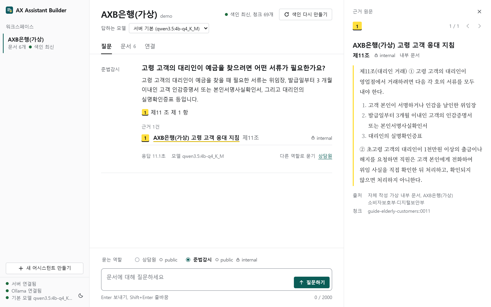
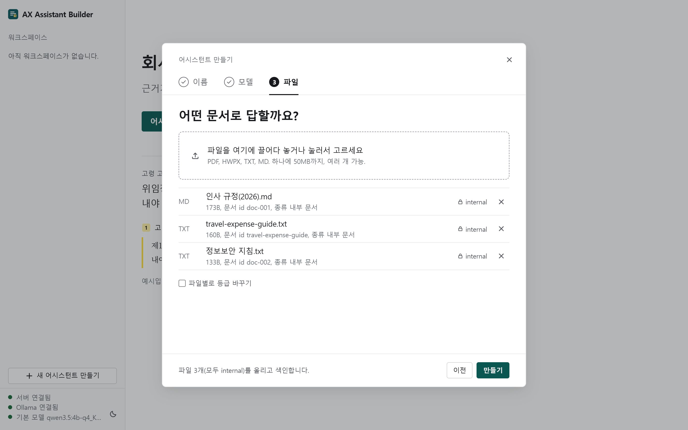
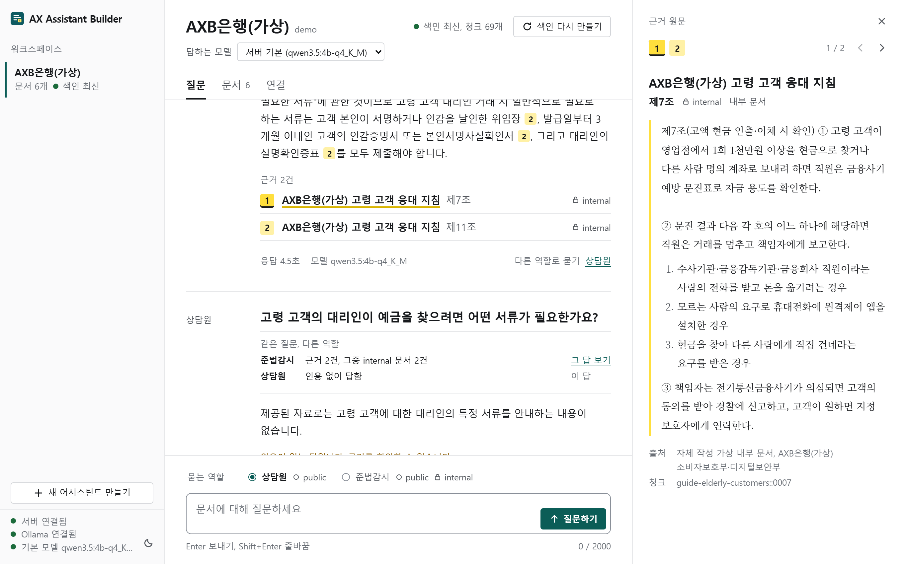
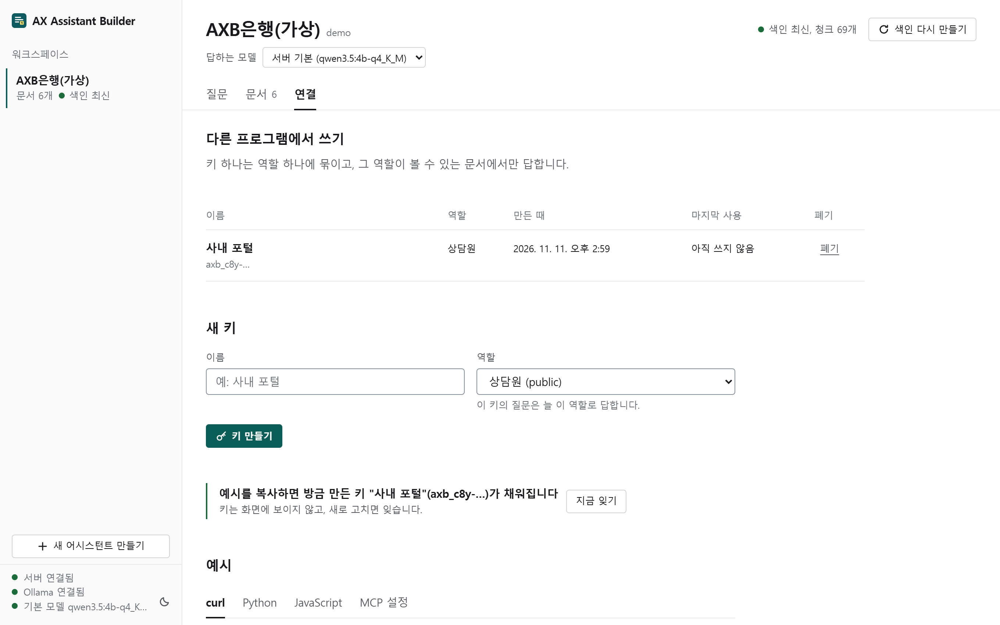
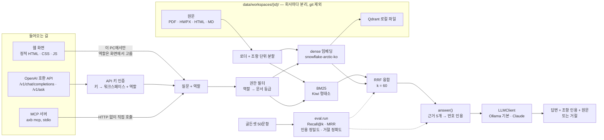

# AX Assistant Builder

**회사 문서를 넣으면, 조항을 인용해 답하고 근거가 없으면 답하지 않는 그 회사 전용 어시스턴트를 로컬 모델만으로 만든다.**

[](https://github.com/Growcompany/ax-assistant-builder/actions/workflows/ci.yml)
[](https://github.com/Growcompany/ax-assistant-builder/releases)




*`준법감시` 역할로 물은 화면. 내부 지침 제11조를 번호로 인용해 답하고, 인용을 누르면 오른쪽에 근거 원문이 열린다. 실제 서버와 로컬 모델(`qwen3.5:4b-q4_K_M`)의 화면이다.*

<table>
  <tr>
    <td width="33%"></td>
    <td width="33%"></td>
    <td width="33%"></td>
  </tr>
  <tr>
    <td><b>만들기 3단계.</b> 이름 → 모델 → 파일. 한글 파일 이름도 된다. "만들기"를 누르면 올리고 색인한다.</td>
    <td><b>같은 질문, 다른 역할.</b> <code>상담원</code>에게는 내부 지침이 검색되지 않아 "확인할 수 없다"고 답한다. 4B 모델이 그 답에 무관한 인용을 붙인 것도 그대로 보인다(<a href="#한계">한계</a>).</td>
    <td><b>연결 탭.</b> 역할에 묶인 API 키를 만들고 curl·Python·JavaScript·MCP 예시를 복사해 쓴다.</td>
  </tr>
</table>

## 무엇인가

- **만든다.** 회사 문서(PDF·HWPX·TXT·MD)를 올리면 그 회사 전용 어시스턴트가 된다. 질문에는 조항을 번호로 인용해 답하고, 근거가 없으면 정해진 문구로 거절한다.
- **권한을 지킨다.** 문서마다 등급이 있고 역할마다 볼 수 있는 등급이 다르다. 권한 밖 문서는 검색 단계에서 빠지므로 같은 질문도 역할에 따라 답이 다르다.
- **로컬에서 돈다.** 기본 설정에서는 검색·임베딩·생성이 모두 이 PC에서 돈다. 문서와 질문을 외부 API로 보내지 않는다(단서는 [한계](#한계)의 "운영").
- **다른 도구에서 쓴다.** 만든 어시스턴트를 OpenAI 호환 API와 MCP 서버로 꺼내 쓴다. 키 하나는 역할 하나에 묶인다.

대표 사례는 가상 은행 워크스페이스다. 문서 13개(실제 법령·고시·약관 7개, 가상 문서 6개)와 사람 검수 전 골든셋 50문항으로 검색을 재 보니 Recall@5가 dense 0.886, BM25+dense 하이브리드 0.864, BM25 0.841이었다([결과](#결과-m-1-기준선)). 학사 졸업 후 AI/AX 엔지니어 직무에 지원하려고 만드는 포트폴리오다.

릴리스는 v0.1.0(검색·인용 답변·평가·REST API) 하나다. 웹 화면, 모델 선택, API 키·OpenAI 호환 API·MCP는 그 뒤에 추가했고 아직 새 버전으로 묶지 않았다.

## 빠른 시작

```bash
git clone https://github.com/Growcompany/ax-assistant-builder.git
cd ax-assistant-builder
python -m venv .venv
source .venv/bin/activate              # Windows Git Bash: source .venv/Scripts/activate
pip install -e ".[dev]"

# 임베딩(색인·질문에 필요): 환경에 맞는 PyTorch를 먼저 설치한다 (https://pytorch.org)
pip install torch==2.15.0 --index-url https://download.pytorch.org/whl/cu132   # 확인한 환경(Windows, CUDA)의 명령
pip install -e ".[ml]"

# 로컬 LLM: Ollama를 설치하고(https://ollama.com) 기본 모델을 받는다
ollama pull qwen3.5:4b-q4_K_M

axb serve                              # 서버를 띄우고 브라우저를 연다
```

`axb serve`가 시작하며 알리는 줄이다(2026-11-11 실제 출력, 뒤에 uvicorn 로그가 이어진다).

```text
Ollama: 연결됨
기본 모델: qwen3.5:4b-q4_K_M (설치됨)
화면: http://127.0.0.1:8000  (끝내려면 Ctrl+C)
```

브라우저에서 둘 중 하나를 고른다.

- **어시스턴트 만들기**: 이름 → 모델 → 파일 3단계. 워크스페이스 생성, 업로드, 색인을 차례로 한다.
- **예시 은행으로 먼저 써 보기**: 저장소의 가상 은행 문서 6개를 등록한다. 색인을 만든 뒤 `상담원`과 `준법감시` 역할로 같은 질문을 해 본다.

<details>
<summary>설치할 때 주의할 점 (Windows, torch 순서, 모델 크기, 옵션)</summary>

- **확인한 환경**: Windows 11 + Git Bash, Python 3.13, RTX 3070 Ti 8GB. `pyproject.toml`의 조건은 Python 3.11 이상이다. CI(GitHub Actions, Ubuntu)는 `.[dev]` 설치와 단위 테스트만 돌린다.
- **가상환경 활성화**: Windows PowerShell은 `.venv\Scripts\Activate.ps1`이다.
- **torch를 먼저.** torch 없이 `.[ml]`부터 설치하면 pip가 PyPI의 torch를 가져온다. Windows에서는 이것이 CPU용이다.
- **임베딩 모델**: 첫 색인 때 `dragonkue/snowflake-arctic-embed-l-v2.0-ko`(Hugging Face 캐시 기준 약 2.2GB)를 받는다.
- **Ollama가 꺼져 있어도 서버는 뜬다.** 시작 줄과 화면이 할 일(`ollama serve`, `ollama pull <모델>`)을 알려 준다. 모델 내려받기는 서버가 대신하지 않는다.
- **`axb serve` 옵션**: `--port`(기본 8000), `--host`(기본 127.0.0.1), `--no-browser`, `--data-dir`(기본: `AXB_DATA_DIR` 또는 `data`). 실행 파일 없이 `python -m axbuilder.cli serve`로도 된다. `uvicorn axbuilder.api.main:app`으로 직접 띄울 수도 있다(주의점은 [ADR 0005](docs/adr/0005-integration-surface.md#운영-경고)).
- **환경 변수**: [`.env.example`](.env.example)에 `AXB_*` 전체와 기본값이 있다. 코드는 `.env` 파일을 읽지 않고 환경 변수만 본다.
- **pip 미러**: 이 저장소를 만든 PC는 시스템 pip 설정에 응답하지 않는 미러가 있어서 `PIP_CONFIG_FILE=nul pip install …`로 설정 파일을 무시했다. 보통은 필요 없다.

</details>

## 주요 기능

| 기능 | 어떻게 |
|---|---|
| 조항 단위 분할 | "제N조"가 2개 이상인 문서는 조항 단위로, 아니면 800자 고정 길이로 나눈다 |
| 하이브리드 검색 | 직접 구현한 Kiwi 형태소 BM25와 한국어 dense 임베딩의 순위를 RRF(k = 60)로 합친다 |
| 번호 인용과 근거 원문 | 답의 `[n]`이 문서·조항을 가리킨다. 화면에서 누르면 그 질문에서 검색된 청크 원문이 열린다 |
| 근거 없으면 거절 | 근거 청크 5개만 보고 답하게 하고, 없으면 정해진 문구(`제공된 자료로는 확인할 수 없습니다.`)로 답하게 한다 |
| 문서 등급별 권한 | 역할 → 볼 수 있는 등급. 검색 단계에서 걸러 권한 밖 문서는 LLM 프롬프트에 들어가지 않는다 |
| 워크스페이스별 모델 선택 | Ollama에 설치된 모델 목록에서 고른다. 응답의 `model`이 실제로 답한 모델이다 |
| 빠른 만들기 | 화면이 생성 → 업로드 → 색인을 차례로 부른다. 기본 등급은 좁은 쪽(`internal`)이다 |
| OpenAI 호환 API | `/v1/chat/completions`. 기존 클라이언트의 `base_url`만 바꾼다. 키가 워크스페이스와 역할을 정하고 요청은 역할을 고르지 못한다 |
| MCP 서버 | `axb mcp`(stdio). 도구는 `list_workspaces`와 `ask`. `--workspace`·`--role`로 고정할 수 있다 |
| 평가 CLI | 골든셋으로 Recall@k·MRR·인용 정밀도·거절 정확도를 재고 보고서 JSON을 남긴다 |

## 기술 스택

"직접 구현"은 라이브러리의 기능을 쓰지 않고 이 저장소의 코드로 짠 것이다.

| 영역 | 사용한 것 | 구분 | 왜·어떻게 |
|---|---|---|---|
| 언어·런타임 | Python 3.11 이상(확인은 3.13), pydantic 2 | 라이브러리 | 설정·요청·저장 파일을 모델로 검증한다 |
| API | FastAPI, uvicorn | 라이브러리 | 화면, 관리 API, `/v1`을 서버 하나가 내준다 |
| 화면 | HTML 하나, CSS 하나, ES 모듈 JS. 빌드 도구·프레임워크 없음 | **직접 구현** | 폐쇄망에서 외부 요청 없이 떠야 한다. 글자는 텍스트 노드로만 넣고 CSP를 붙인다 → [ADR 0004](docs/adr/0004-web-ui-static.md) |
| 형태소 분석 | Kiwi(`kiwipiepy` 0.24) | 라이브러리 | BM25의 토큰을 공백이 아니라 형태소 단위로 자른다 |
| 키워드 검색 | BM25 | **직접 구현** | 점수 계산과 색인을 직접 짰다 → [Task 1 학습 노트](docs/learning/task-01-bm25.md) |
| 의미 검색 | `dragonkue/snowflake-arctic-embed-l-v2.0-ko`(sentence-transformers), Qdrant 로컬 모드 | 라이브러리 | 별도 서버 없이 워크스페이스 폴더 안의 파일로 색인한다 |
| 순위 융합 | RRF(k = 60, 검색기마다 후보 30개) | **직접 구현** | 점수 척도가 다른 두 검색기를 순위만으로 합친다 → [ADR 0002](docs/adr/0002-hybrid-rrf.md) |
| LLM | Ollama `qwen3.5:4b-q4_K_M`(기본). Claude로 전환 가능 | 프로토콜은 **직접 구현**, Claude 호출은 anthropic SDK | `generate(system, user)` 하나 뒤에 둔다. Claude 경로는 모의 테스트까지만 했다 → [ADR 0003](docs/adr/0003-llm-protocol-local-first.md) |
| 문서 파싱 | PDF: pdfplumber. HWPX·법령 HTML: 표준 라이브러리 | PDF는 라이브러리, HWPX·HTML은 **직접 구현** | HWPX는 ZIP 안의 XML에서 글자만 모으고 자원 상한을 둔다 |
| 외부 연결 (HTTP) | OpenAI 호환 응답 모양, API 키(SHA-256 해시 저장) | **직접 구현** | 서버에 `openai` 의존성이 없다 → [ADR 0005](docs/adr/0005-integration-surface.md) |
| 외부 연결 (MCP) | MCP SDK(`mcp>=2`, 선택 설치) | 라이브러리 | 기본 설치와 단위 테스트는 SDK 없이 돈다 |
| 품질 | pytest, ruff, GitHub Actions | 라이브러리 | 단위 테스트는 네트워크·GPU·모델 없이 돈다. 실제 모델 테스트는 `slow` 표시로 분리한다 |

## 다른 곳에서 쓰기

**1. 키를 만든다.** 화면의 **연결** 탭에서 역할을 골라 발급한다. 원문(`axb_`로 시작)은 만들 때 한 번만 보이고, 서버에는 SHA-256 해시만 남는다. 키 하나는 워크스페이스 하나와 역할 하나에 묶인다.

**2. curl** (`model`은 워크스페이스 id다. 아래는 예시 은행 `demo`)

```bash
curl http://127.0.0.1:8000/v1/chat/completions \
  -H "Authorization: Bearer axb_..." \
  -H "Content-Type: application/json" \
  -d '{"model": "demo", "messages": [{"role": "user", "content": "고령 고객의 대리인이 예금을 찾으려면 어떤 서류가 필요한가요?"}]}'
```

**3. Python `openai` SDK** (`base_url`만 바꾼다. `openai` 패키지는 따로 설치한다)

```python
from openai import OpenAI

client = OpenAI(base_url="http://127.0.0.1:8000/v1", api_key="axb_...")
reply = client.chat.completions.create(
    model="demo",
    messages=[
        {"role": "user", "content": "고령 고객의 대리인이 예금을 찾으려면 어떤 서류가 필요한가요?"}
    ],
)
print(reply.choices[0].message.content)
```

답변 본문 끝에 `출처` 목록이 글자로 붙는다. 구조화된 값은 응답의 확장 필드 `axb`에 있다: `refused`(거절 여부), `citations`(인용), `passages`(인용한 원문), `model`, `latency_ms`. OpenAI 모양이 필요 없으면 `POST /v1/ask`에 `{"question": "…"}`만 보낸다.

**4. MCP** (Claude Desktop 같은 MCP 클라이언트의 설정. 먼저 `pip install -e ".[mcp]"`)

```json
{
  "mcpServers": {
    "axb-demo": {
      "command": "axb",
      "args": ["mcp", "--data-dir", "<데이터 폴더의 절대 경로>", "--workspace", "demo", "--role", "상담원"]
    }
  }
}
```

`--workspace`와 `--role`을 주면 그것으로 고정되고, 도구는 워크스페이스·역할 인자를 받지 않는다. `axb mcp`는 API 키를 쓰지 않는다. 그 명령을 실행하는 사람이 이 PC의 데이터 주인이기 때문이다.

**경계: 어디서 무엇을 쓸 수 있나**

| 경로 | 누가 | 조건 |
|---|---|---|
| 화면, 관리 API(워크스페이스·업로드·색인·키 발급·`/workspaces/{id}/ask`), `/docs` | 이 PC에서 온 요청만 | 밖에서 오면 403. 유효한 키가 있어도 마찬가지다 |
| `/v1/*` | 어디서든 | 키가 없거나 틀리면 401. 이 PC에서 불러도 키가 필요하다 |
| `axb mcp` | 이 PC에서 실행한 사람 | 키 없음(stdio) |

- **다른 PC에서 쓰려면** `AXB_ALLOWED_HOSTS=127.0.0.1,localhost,<이 PC의 IP 또는 이름> axb serve --host 0.0.0.0`으로 띄운다. 그래도 밖에서는 키로 `/v1/*`만 쓸 수 있다.
- **평문 HTTP다.** 그렇게 열면 키, 질문, 답변(내부 문서 발췌 포함)이 네트워크를 그대로 지나간다.
- **"이 PC에서 왔는가"는 인증이 아니다.** 프록시, SSH 터널, 포트 전달을 거친 요청은 이 PC로 보인다. 프록시 뒤에 두거나 `uvicorn`으로 직접 띄우기 전에 [ADR 0005의 운영 경고](docs/adr/0005-integration-surface.md#운영-경고) 7개를 읽는다.

<details>
<summary>전체 경로 표</summary>

| 메서드 | 경로 | 하는 일 |
|---|---|---|
| GET | `/`, `/static/…` | 화면 파일. CSP·nosniff 머리글을 붙인다 |
| GET | `/health` | 서버가 떠 있는지 확인: `{"status": "ok"}`. 모델을 불러오지 않는다 |
| GET | `/models` | Ollama에 설치된 모델 목록 |
| GET | `/workspaces`, `/workspaces/{id}` | 목록, 상세(문서 목록, 색인 상태) |
| POST | `/workspaces` | 워크스페이스(이름, 역할 → 문서 등급) 만들기. 같은 id가 있으면 409 |
| PATCH | `/workspaces/{id}` | 답하는 모델(`llm_model`) 바꾸기 |
| POST | `/demo-workspace` | 가상 은행 문서 6개로 워크스페이스 `demo` 만들기(색인은 하지 않는다) |
| POST | `/workspaces/{id}/documents` | 문서 업로드: PDF·HWPX·TXT·MD, 50MB까지. `access_level` 필수 |
| POST | `/workspaces/{id}/index` | BM25 + dense 색인 |
| POST | `/workspaces/{id}/ask` | `{"question", "role"}` → `{"answer", "citations", "passages", "refused", "model", "latency_ms"}` |
| POST · GET | `/workspaces/{id}/keys` | 키 발급(201, 원문은 이 응답에만) · 목록 |
| DELETE | `/workspaces/{id}/keys/{key_id}` | 키 폐기(204) |
| GET | `/v1/models` | 그 키의 워크스페이스 하나 |
| POST | `/v1/chat/completions` | OpenAI chat.completion 모양. `stream=true`면 SSE. `model`이 키의 워크스페이스 id가 아니면 404 |
| POST | `/v1/ask` | `{"question"}` → `/workspaces/{id}/ask`와 같은 모양의 응답 |

`/v1/*`의 오류는 OpenAI 모양(`{"error": {message, type, code, param}}`)이다.

</details>

## 아키텍처



| 단계 | 구현 | 위치 |
|---|---|---|
| 파싱·분할 | PDF(pdfplumber), HWPX(표준 라이브러리 XML), 법령 HTML. "제N조"가 2개 이상이면 조항 단위, 아니면 800자 고정 길이 | `src/axbuilder/ingest/` |
| 검색 | BM25와 RRF는 직접 구현. dense는 `dragonkue/snowflake-arctic-embed-l-v2.0-ko` + Qdrant(로컬 모드) | `src/axbuilder/retrieval/` |
| 생성 | 근거 청크 5개만 보고 답하게 하는 프롬프트. 인용 번호를 다시 매기고, 범위 밖 번호는 지운다. 정해진 문구로 시작하면 거절 | `src/axbuilder/generation/` |
| 평가 | 골든셋 검증, Recall@k·MRR·인용 정밀도·거절 정확도, 보고서 JSON | `src/axbuilder/eval/` |
| 관리 API | 워크스페이스, 업로드(파일 이름·크기·형식 서명 검사, HWPX 해제량 상한·DTD 거부, PDF 해제량·쪽당 객체 수 상한. PDF 파싱 CPU 시간은 아직 못 묶음 → [한계](#한계)), 색인, 질문, 모델 목록·선택 | `src/axbuilder/api/app.py` |
| 화면 | 사이드바(워크스페이스 목록), 질문·문서·연결 탭, 근거 패널, 만들기 대화상자. 서버가 준 글자는 텍스트 노드로만 넣는다 | `src/axbuilder/api/static/` |
| 외부 연결 | API 키(`keys.py`), OpenAI 호환 `/v1`(`v1.py`), MCP 서버(`mcp_server.py`) | `src/axbuilder/api/`, `src/axbuilder/mcp_server.py` |
| 접근 규칙 | `/v1/*`는 키, 그 밖의 경로는 loopback에서 온 요청만. Host 허용 목록, 다른 출처 요청 거절, 본문 크기 상한 | `src/axbuilder/api/access.py`, `app.py` |
| 실행 | `axb serve`, `axb mcp`, `axb --version` | `src/axbuilder/cli.py` |

## 핵심 결정 7개

1. **모든 데이터를 회사(워크스페이스) 폴더 단위로 나눈다.** 컬렉션 하나에 회사 id 필터를 거는 방식은 필터를 한 번만 빠뜨려도 다른 회사 문서가 섞인다. → [ADR 0001](docs/adr/0001-workspace-isolation.md)
2. **검색 코어(BM25·RRF)는 직접 구현하고, BM25와 dense를 RRF로 합친다.** 단, 첫 실험에서는 dense 단독이 더 좋았다. 기본값은 잠정으로 두고 M-2에서 다시 정한다. → [ADR 0002](docs/adr/0002-hybrid-rrf.md)
3. **LLM은 `generate(system, user)` 프로토콜 하나 뒤에 두고, 기본값은 로컬(Ollama, qwen3.5 4B)이다.** 폐쇄망 고객을 기본으로 놓았다. 테스트는 가짜 LLM으로 네트워크 없이 돈다. → [ADR 0003](docs/adr/0003-llm-protocol-local-first.md)
4. **권한은 생성이 아니라 검색 단계에서 거르고, 근거가 없으면 정해진 문구로 거절하게 한다.** 권한 밖 문서는 LLM 프롬프트에 아예 들어가지 않는다. → [Task 7 학습 노트](docs/learning/task-07-answer.md) (ADR은 M-2 예정)
5. **골든셋은 "정답 + 근거 위치(조항)"로 만들고, 검색과 답변을 따로 잰다.** 검색은 근거 위치로(Recall@k·MRR), 답변은 인용과 거절로 채점한다. → [Task 8](docs/learning/task-08-golden-dataset.md)·[Task 9](docs/learning/task-09-eval-runner.md) 학습 노트 (ADR은 M-2 예정)
6. **화면은 Streamlit 대신 FastAPI가 직접 내주는 빌드 없는 정적 파일이다.** 프로세스와 의존성이 늘지 않고 외부 요청 없이 뜬다. 대가는 직접 쓴 상태 관리와 프런트엔드 단위 테스트가 없는 것이다. → [ADR 0004](docs/adr/0004-web-ui-static.md)
7. **밖에서 쓰는 길은 OpenAI 호환 API와 MCP이고, 키는 역할 하나에 묶고, 관리는 이 PC에서만 한다.** 요청이 역할을 적어 보내면 누구나 높은 역할을 적는다. 그래서 키로 온 요청은 역할을 고르지 못한다. → [ADR 0005](docs/adr/0005-integration-surface.md)

## 결과 (M-1 기준선)

출처: [`docs/experiments/2026-11-10-baseline.md`](docs/experiments/2026-11-10-baseline.md). 설정, 재현 명령, 실패 사례, 시간이 모두 그 문서에 있다.

**조건**: 골든셋 v0 50문항(lookup 30, table 8, multi_doc 6, out_of_scope 6). 에이전트가 문서를 보고 만든 초안이고 **사람 검수 전**이다([15문항 표본 검수표](docs/eval/golden-v0-review-sheet.md), 검수 대기). 코퍼스는 13개 문서, 945청크다. 역할은 `준법감시`(public + internal), k = 5다.

**검색** (범위 밖 6문항을 뺀 44문항)

| 구분 | n | BM25 R@5 | BM25 MRR | dense R@5 | dense MRR | hybrid R@5 | hybrid MRR |
|---|---|---|---|---|---|---|---|
| **전체** | 44 | 0.841 | 0.746 | **0.886** | **0.880** | 0.864 | 0.824 |
| 조항 단위 근거만 | 25 | 0.780 | 0.653 | 0.820 | 0.808 | 0.800 | 0.710 |
| 문서 단위 근거 포함 | 19 | 0.921 | 0.868 | 0.974 | 0.974 | 0.947 | 0.974 |

**답변** (hybrid + `qwen3.5:4b-q4_K_M`, 50문항, 한 번 실행)

| 구분 | n | 근거 n | Recall@5 | MRR | 인용 n | 인용 정밀도 | 거절 정확도 |
|---|---|---|---|---|---|---|---|
| **전체** | 50 | 44 | 0.864 | 0.824 | 39 | 0.662 | 0.860 |
| out_of_scope | 6 | 0 | - | - | 1 | 0.000 | 0.333 |

**읽을 때 주의할 점**

- **dense가 hybrid보다 좋았다.** 하이브리드가 늘 낫다는 가정과 반대다. RRF는 두 검색기 모두에 나온 청크를 우선한다. 그래서 두 후보 목록(각 30개)에 함께 나온 청크가 5개 이상이면, BM25 후보에 없는 정답은 dense가 1위로 찾아도 상위 5개에 들지 못한다(bank-029). 반대로 dense가 놓치고 hybrid가 찾은 문항도 있다(bank-009). 다만 Recall@5 차이는 **한 문항**이다. 44문항에서 한 문항은 약 0.023이라 순위는 바뀔 수 있다. → [ADR 0002](docs/adr/0002-hybrid-rrf.md)
- **문서 단위 근거가 Recall을 부풀린다.** 상품설명서는 조항이 없어 근거를 문서 단위로 달았다. 그래서 그 문서의 청크 6개 중 아무거나 나와도 정답이다. 반면 조항 근거는 예컨대 은행법 청크 256개 중 1개만 정답이다. 조항 근거만 있는 25문항의 R@5는 0.780 / 0.820 / 0.800으로, 전체 수치보다 낮다. "조항을 정확히 찾는 능력"은 이 행으로 읽어야 한다.
- **거절 판정이 바꿔 말한 거절을 놓친다.** 판정은 "답이 정해진 문구(`제공된 자료로는 확인할 수 없습니다.`)로 시작하는가"라는 글자 규칙이다. 범위 밖 6문항 중 4개는 모델이 문구를 바꿔 거절했고, 지표는 이것을 답변으로 셌다(0.333). 사람이 읽어 보면 6문항 모두 답을 피했다. 반대로 근거를 가져왔는데 거절한 과잉 거절이 3/39다. out_of_scope 행의 인용 정밀도 0.000은 인용을 단 1문항(046)의 값이다.
- **답변 지표는 한 번 실행한 값이다.** 같은 설정의 다른 실행에서는 인용 정밀도가 0.707이었고, 릴리스 후 다시 돌린 세 번째 실행에서는 0.677이었다([실험 기록](docs/experiments/2026-11-10-baseline.md)의 "릴리스 후 재현 확인"). 인용 정밀도는 위치만 본다. 그래서 맞는 조항을 인용하고 내용을 틀리게 옮긴 답(bank-030)은 잡지 못한다.
- 시간: 답변 지연은 중앙값 4,358.52 ms, 평균 6,988.64 ms, 최대 68,855.43 ms다. 검색만 하면 질문당 평균 dense 30.81 ms, BM25 0.84 ms다(RTX 3070 Ti 8GB).

### 평가 다시 돌리기

```bash
pytest -q                                  # 단위 테스트. 실제 모델·네트워크를 쓰는 테스트(slow)는 빠진다
python scripts/download_corpus.py bank     # 법령·고시 5개(국가법령정보센터), 표준약관 2개(공정위)를 받는다
python -m axbuilder.eval.run --workspace bank --retriever bm25 --k 5      # GPU 없이
python -m axbuilder.eval.run --workspace bank --retriever hybrid --k 5    # 임베딩 모델 필요(.[ml])
python -m axbuilder.eval.run --workspace bank --retriever hybrid --k 5 --with-llm   # Ollama 필요. 50문항, 확인한 PC에서 4~7분
```

원문은 `data/workspaces/bank/raw/`에 저장된다(git 제외). 가상 문서 6개는 저장소에 있다. 평가 결과는 표로 출력되고, `reports/bank/`에 JSON으로 남는다. `--retriever`는 `bm25`·`dense`·`hybrid` 중 하나다.

Claude로 바꾸려면 `AXB_LLM_MODE=cloud`와 `ANTHROPIC_API_KEY`를 설정하고 `--allow-cloud`를 더한다. 문항마다 유료 API를 부른다.

<details>
<summary>API로 직접 호출한 실제 출력 (2026-11-10, 화면이 생기기 전의 기록)</summary>

화면 없이 API로 질문한 결과를 그대로 싣는다. 2026-11-10에 한 번 실행했고, 아래 코드로 다시 돌릴 수 있다. 모델 출력은 실행마다 달라진다.

워크스페이스에는 저장소에 있는 가상 문서 6개만 올렸다. 상품설명서 3개는 `public`, 내부 지침 3개는 `internal`이다. `상담원`은 public만, `준법감시`는 둘 다 볼 수 있다. 모델은 로컬 `qwen3.5:4b-q4_K_M`이다.

| 역할 | 질문 | 시스템의 답 (요약) | 사람이 본 판정 |
|---|---|---|---|
| 상담원 | 든든 정기예금 12개월 만기일시지급식 기본금리는? | "연 2.55%입니다 [1]" — 정기예금 설명서 인용 | **오답.** 정답은 2.80%("12개월 이상 24개월 미만" 행)다. "12개월"이 든 바로 윗 행을 읽었다. 인용한 문서는 맞아서 인용 정밀도로는 잡히지 않는다 |
| 상담원 | 고령 고객의 대리인이 예금을 찾을 때 필요한 서류는? | "제공된 자료로는 … 확인할 수 없습니다" + 상품설명서 2개 인용, `refused=false` | **권한 필터는 맞게 동작했다.** 답은 내부 지침에만 있어서 상담원의 검색 결과에 들어오지 않았고, 모델도 지어내지 않았다. 다만 정해진 거절 문구를 바꿔 말해서 시스템은 답변으로 셌고, 무관한 인용이 붙었다 |
| 준법감시 | 같은 질문 | 위임장, 3개월 이내 인감 증명서 또는 본인 서명 사실 확인서, "대리인의 실명 확정 표시" [1: 고령 고객 응대 지침 제11조] + 초고령 고객 규정 [2] | **대체로 맞다.** 서류 3개와 근거 조항이 맞다. 다만 "실명확인증표"를 "실명 확정 표시"로 옮겼다. 덧붙인 초고령 고객 규정(제11조 ②)에는 엉뚱한 조항(상담 응대 지침 제4조)을 인용했다 |
| 상담원 | AXB은행 신용카드 연회비는? | "제공된 자료로는 확인할 수 없습니다." `refused=true` | **맞다.** 자료에 없는 질문을 정해진 문구로 거절했다 |

실제 출력 전문:

```text
{'chunks': 69}

[상담원] AXB 든든 정기예금에 12개월 만기일시지급식으로 가입하면 기본금리는 몇 %인가요?
refused=False
AXB 든든 정기예금 12개월 만기 일시지급식의 기본금리는 연 2.55%입니다 [1].
  [1] AXB 든든 정기예금 상품설명서

[상담원] 고령 고객의 대리인이 예금을 찾으려면 어떤 서류가 필요한가요?
refused=False
제공된 자료로는 고령 고객의 대리인이 예금을 찾을 때 필요한 구체적인 서류는 확인할 수 없습니다. [1], [2]에는 적금 해지 시 증명 가능한 사유 (결혼, 출산, 주택 구입 등) 에 해당하는 증빙 서류가 나열되어 있으나, 대리인 접근 관련 서류나 고령 고객 우대 수수료 안내와 별개로 대리인의 자격이나 필요 서류에 대한 설명은 포함되어 있지 않습니다.
  [1] AXB 자유로운 적금 상품설명서
  [2] AXB 든든 정기예금 상품설명서

[준법감시] 고령 고객의 대리인이 예금을 찾으려면 어떤 서류가 필요한가요?
refused=False
고령 고객의 대리인이 영업점에서 거래하려면 다음 각 호의 서류를 모두 제출해야 합니다.
- 고객 본인이 서명하거나 인감을 날인한 위임장 [1].
- 발급일부터 3 개월 이내인 고객의 인감 증명서 또는 본인 서명 사실 확인서 [1].
- 대리인의 실명 확정 표시 [1].

또한, 초고령 고객의 대리인이 1 천만원 이상의 출금이나 해지를 요청할 경우, 직원은 고객 본인에게 전화하여 위임 사실을 직접 확인한 뒤 처리하고, 확인되지 않으면 처리하지 아니합니다 [2].
  [1] AXB은행(가상) 고령 고객 응대 지침 제11조
  [2] AXB은행(가상) 상담 응대 지침 제4조

[상담원] AXB은행 신용카드의 연회비는 얼마인가요?
refused=True
제공된 자료로는 확인할 수 없습니다.
```

위 출력을 만든 코드다. 저장소 루트에서 파일로 저장해 실행한다. 서버(`axb serve --no-browser`)와 Ollama가 켜져 있어야 한다. 같은 id로 워크스페이스를 다시 만들면 409가 난다. 화면의 "예시 은행으로 먼저 써 보기"도 id `demo`를 쓴다. 다시 돌릴 때는 서버를 새 `AXB_DATA_DIR`로 띄우거나 `data/workspaces/demo/`를 지운다.

```python
import sys
from pathlib import Path

import httpx

from axbuilder.corpus import load_sources

sys.stdout.reconfigure(encoding="utf-8")  # Windows 콘솔에서 한글이 깨지지 않게
api = httpx.Client(base_url="http://127.0.0.1:8000", timeout=300)

# 1) 워크스페이스: 역할마다 볼 수 있는 문서 등급
api.post(
    "/workspaces",
    json={
        "id": "demo",
        "name": "AXB은행(가상)",
        "industry": "finance",
        "roles": {"상담원": ["public"], "준법감시": ["public", "internal"]},
    },
).raise_for_status()

# 2) 저장소에 있는 가상 문서 6개 업로드: 상품설명서 3개(public), 내부 지침 3개(internal)
fields = {"doc_id", "title", "source", "doc_type", "access_level"}
for s in load_sources(Path("corpus/bank/sources.yaml")):
    if s.path:  # url로 받는 법령·약관은 건너뛴다
        with open(s.path, "rb") as f:
            api.post(
                "/workspaces/demo/documents",
                data=s.model_dump(include=fields),
                files={"file": (Path(s.path).name, f)},
            ).raise_for_status()

# 3) 색인: BM25 + dense (첫 호출 때 임베딩 모델을 불러온다)
print(api.post("/workspaces/demo/index").json())

# 4) 질문: 역할이 다르면 검색되는 문서가 다르다
for role, question in [
    ("상담원", "AXB 든든 정기예금에 12개월 만기일시지급식으로 가입하면 기본금리는 몇 %인가요?"),
    ("상담원", "고령 고객의 대리인이 예금을 찾으려면 어떤 서류가 필요한가요?"),
    ("준법감시", "고령 고객의 대리인이 예금을 찾으려면 어떤 서류가 필요한가요?"),
    ("상담원", "AXB은행 신용카드의 연회비는 얼마인가요?"),
]:
    r = api.post("/workspaces/demo/ask", json={"question": question, "role": role}).json()
    print(f"\n[{role}] {question}\nrefused={r['refused']}\n{r['answer']}")
    for i, c in enumerate(r["citations"], 1):
        print(f"  [{i}] {c['title']} {c['article'] or ''}")
```

</details>

## 지금 되는 것과 아직 없는 것

| 지금 되는 것 | 아직 없는 것 |
|---|---|
| PDF·HWPX·HTML·MD 파싱, 조항 단위 분할 | 리랭커, 골든셋 150~200문항, LLM-judge (**M-2 예정**) |
| Kiwi 형태소 BM25(직접 구현) + 한국어 dense + RRF | 에이전트(질의 분류·재검색·사람에게 넘기기), 개인정보 마스킹, 사용자 계정·로그인 (M-3 예정) |
| 문서 등급별 권한 필터(검색 단계), 번호 인용, 고정 거절 문구 | Docker Compose 원커맨드 실행 (M-5 예정) |
| 로컬 LLM(Ollama) / Claude 전환(Claude는 모의 테스트까지, 실제 호출은 M-2), 50문항 평가 CLI | 데모 GIF(지금은 스크린샷) |
| 웹 화면: 만들기 3단계, 질문과 근거 원문, 역할 바꿔 다시 묻기, 문서 올리기 | 화면의 대화 저장, 문서 삭제, 역할 수정 |
| 워크스페이스별 로컬 모델 선택, `axb serve` 한 줄 실행 | 토큰 단위 스트리밍, 대화 이력을 쓰는 답변 |
| 역할에 묶인 API 키, OpenAI 호환 API(`/v1`), MCP 서버 | 키 사용량·시도 횟수 제한, 키 만료일, TLS |

"지금 되는 것"의 위 네 행은 v0.1.0 릴리스에 들어 있다. 아래 세 행은 릴리스 뒤에 추가했다. 설계 문서는 화면을 Streamlit으로 일정 마지막(M-6)에 두었는데, 정적 화면으로 바꿔 앞당겼다([ADR 0004](docs/adr/0004-web-ui-static.md)).

## 한계

- **평가가 작고 검수 전이다.** 골든셋은 50문항이고 사람 검수 전이다. 문서를 보고 만들어서, 50문항 중 12개는 원문 문장을 바꿔 쓴 질문이다(BM25에 유리). 조항 번호로 묻는 질문은 없다. 역할은 `준법감시` 하나로만 쟀다.
- **지표가 못 재는 것이 있다.** 거절 판정은 글자 규칙이고, 인용 정밀도는 위치만 본다. 내용이 틀린 답은 M-2의 답변 채점(LLM-judge + 사람 채점)으로 잡아야 한다.
- **4B 로컬 모델의 한계.** 표의 행을 잘못 읽는다(위 API 출력 기록의 2.55%). 정해진 거절 문구를 지키지 않고, 그 거절에 무관한 인용을 달기도 한다. 답은 실행마다 달라서, 같은 질문에도 인용을 빠뜨릴 때가 있다.
- **검색.** 리랭커가 아직 없다. 청크의 41%가 부칙이라 잡음이 된다. 조항을 항·호 단위로 더 나누지 않는다. 본문 조항은 최대 3,572자(전자금융거래법 제2조)다. 가장 긴 청크 11,452자는 본문이 아니라 다른 법률 개정 지시문이 붙은 부칙 조항(금소법 부칙 제13조)이다.
- **화면.** 대화는 브라우저 메모리에만 있어 새로 고치면 사라진다. 문서 삭제와 역할 수정이 없다(API에도 없다). 프런트엔드 자동 테스트가 없다. 위험한 API(`innerHTML` 등)와 깨진 파일 참조를 찾는 정적 검사, 화면이 쓰는 API의 파이썬 테스트, 브라우저 수동 확인으로 대신한다. 화면 동작의 회귀는 사람이 다시 눌러 봐야 드러난다([ADR 0004](docs/adr/0004-web-ui-static.md)).
- **외부 연결.** `/v1/chat/completions`는 OpenAI API의 일부만 한다. `stream=true`는 토큰 단위가 아니라 완성된 답을 조각 하나로 보낸다. 대화 이력과 system 메시지는 쓰지 않고 마지막 user 메시지만 질문으로 쓴다. `temperature`·`tools` 같은 필드는 읽지 않는다. 키에는 사용량 제한, 틀린 키 시도 횟수 제한, 만료일이 없다(워크스페이스당 키 100개 상한만 있다). 유효한 키로 LLM을 계속 부르는 것은 막지 못한다. `axb serve`가 어떤 워크스페이스의 색인을 열고 있으면 `axb mcp`는 같은 색인을 열지 못한다([ADR 0005](docs/adr/0005-integration-surface.md)).
- **보안.**
  - 사용자 계정이 없다. `/v1/*`에서는 키가 역할을 정하지만, 관리 API(`/workspaces/{id}/ask` 포함)에서는 요청이 역할을 정한다. 그래서 `/v1/*`가 아닌 경로는 이 PC(loopback)에서 온 요청만 받고 밖에서 오면 403이다. **loopback은 인증이 아니다.** 이 PC에서 도는 모든 로컬 프로세스가 관리자이고, SSH 터널·포트 전달·`X-Forwarded-For`를 붙이지 않는 같은 PC의 프록시를 거친 요청도 이 PC로 보인다. `--host 0.0.0.0`으로 열면 평문 HTTP로 키와 답변이 지나간다. 독립 보안 리뷰는 기본이 아닌 실행 방식 두 가지(IPv6 loopback으로 붙는 프록시, `--root-path`)에서 경계가 뚫리는 것을 재현했고, 고친 뒤 [ADR 0005의 운영 경고](docs/adr/0005-integration-surface.md#운영-경고)에 적었다. v0.1.0에는 이 검사와 키가 없다. 그 버전은 127.0.0.1에만 띄워야 한다.
  - 브라우저를 거친 공격은 머리글 두 가지로 막는다. 다른 사이트의 페이지가 보낸 상태 변경 요청은 `Sec-Fetch-Site`로 거절한다. DNS 리바인딩(공격자 도메인이 127.0.0.1로 풀리게 바꿔 "같은 출처"가 되는 공격)은 `Host` 허용 목록으로 거절한다. `Host`가 `127.0.0.1`, `localhost`, `[::1]`(포트는 무엇이든)이 아니면 GET을 포함한 모든 요청이 403이고, `Origin` 머리글이 있으면 그 호스트도 목록에 있어야 한다. 목록은 `AXB_ALLOWED_HOSTS`(쉼표 구분)로 바꾼다. **이것은 인증이 아니다.** `Host`는 curl 같은 클라이언트가 마음대로 적을 수 있어서, 서버 포트에 닿을 수 있는 사람은 그대로 쓸 수 있다. `Origin`은 호스트만 보고 포트는 보지 않는다. 그래서 `Sec-Fetch-Site`를 보내지 않는 구형 브라우저에서는 같은 PC의 다른 포트 페이지가 보낸 요청을 막지 못한다. 유효한 키가 있는 `/v1/*` 요청은 `Origin`·`Sec-Fetch-Site` 검사를 건너뛴다(키는 쿠키와 달리 브라우저가 알아서 붙이지 않는다). `/v1/*`의 CORS는 기본으로 꺼져 있고 `AXB_CORS_ORIGINS`에 적은 출처에만 응답 머리글을 단다.
  - 업로드는 파일 이름(경로 조작), 크기(50MB), 형식 서명을 검사한다. 제목·출처·워크스페이스 이름의 줄바꿈, 제어 문자, 유니코드 **Cf 범주** 문자(방향 제어, 폭 없는 공백 등)는 422다. Cf가 아닌 "보이지 않는 문자"는 통과한다: 변형 선택자, 한글 채움 문자(U+3164 등), 점자 공백(U+2800), 미지정·사용자 영역 문자. 입력 정규화는 M-3에서 다룬다.
  - 파싱하며 쓰는 자원에는 아래 상한을 둔다. 수치는 파일 하나를 읽는 새 프로세스의 시간과 최대 메모리(import만 하면 약 40MB)이고, 같은 PC에서도 실행마다 시간이 2~3배 달랐다.
    - HWPX 해제량: 구역 압축 해제 합계를 50MB로 묶고, 구역 XML의 DTD(엔티티 확장)는 거부한다.
    - HWPX 파서 이벤트: 요소 트리를 만들지 않고 글자만 모으며, 파서 이벤트(요소 하나에 1 + 속성 수, 글자 조각 하나에 1)를 문서당 1,000만 개로 묶는다. 실제 표준약관 HWPX 두 개가 5,771개와 7,365개다. 상한은 표가 정한다: 한컴오피스가 쓰는 표는 칸 하나가 이벤트 55개쯤이라 1,000만은 약 18만 칸이다(처음 잡은 100만은 3,500행 × 6열 표를 거절했다. 그 표는 지금 1.0~1.2초·44MB에 읽힌다). 함께 중첩 깊이 200단(실제 12단), 구역 파일 1,000개(실제 1개), 서로 다른 요소·속성 이름 1만 개, 이벤트 없이 이어지는 토큰(시작 태그·주석) 256KB를 상한으로 둔다. 토큰 상한은 64KB 단위로 재므로 실제로 거절되는 크기는 320~384KB부터다. 막은 것과 수정 전후: 빈 문단 300만 개(30KB 파일) 8.1초·541MB → 3.6초·40MB에 통과(글자가 없어 메모리에 남는 것이 없다), `hp:t` 안 줄바꿈 2천만 개(20KB) 3.4초·361MB → 4.5초·41MB에서 거절, 속성 80만 개짜리 요소 하나(1.7MB) 0.7초·269MB → 0.0초·41MB에서 거절, 999,990단 중첩(19KB) 1.0초·263MB → 0.0초·42MB에서 거절, 이름이 다 다른 요소 90만 개 → 0.0초에 거절. **상한 안에서 드는 비용**(상한을 올린 대가다): 줄바꿈으로 쪼갠 글자 조각 1,000만 개(10MB XML)는 4.9초·191MB, `&lt;` 520만 개는 2.8초·115MB에 통과한다. 빈 문단이나 한 글자 문단만으로 채운 파일은 이벤트 상한보다 해제 상한 50MB에 먼저 걸리고, 거기까지 8~14초·70~77MB를 쓴다. 1,600만 자짜리 글자 노드 하나는 0.3초·104MB다.
    - PDF 쪽 수: 문서당 5,000쪽으로 묶고, 쪽 객체를 만들기 전에 센다(파일에 적힌 `/Count`는 믿지 않는다). 내용 없는 쪽 10만 개가 든 8MB PDF가 30.6초·498MB를 썼고, 지금은 1.4~4.3초·80MB에서 422가 된다.
    - PDF 객체 수: xref들에 적힌 서로 다른 객체 번호를 문서당 100만 개로 묶는다(쪽 상한 5,000쪽 × 쪽당 200개로 잡은 값이고, 실제 대형 PDF로 재 본 것은 아니다). 객체 스트림(ObjStm)에 든 객체도 xref에 한 번씩 적히므로 따로 더하지 않는다: 쪽당 객체 200개짜리 2,600쪽 PDF(객체 52만 개)는 18초·214MB에 읽힌다. 증분 저장으로 같은 번호를 여러 구획에 다시 적은 파일은 한 번만 세되, 구획들이 적은 항목의 합계는 상한의 2배까지만 받는다(구획을 늘려 훑는 횟수를 키우지 못하게). `/Index` 없이 `/Size`만 크게 적은 xref 스트림도 그 수만큼 선언한 것으로 보아 거절한다(main에서는 읽히던 모양이다). 쪽이 하나도 없는 PDF는 pdfminer가 선언된 객체 번호를 전부 훑는데, 그 수는 파일에 적힌 숫자일 뿐이라 199바이트 PDF가 10^12개를 선언하면 끝나지 않았다. 지금은 훑기 전에 거절한다(0.0초). **상한에 딱 맞춰 100만 개를 선언한 187바이트 PDF는 20~34초를 쓴다**(메모리는 40MB 그대로). 객체 스트림은 선언한 객체까지만 파싱한다. xref가 깨져 pdfminer가 파일을 훑어 복구하는 경로에서도 같다: 선언 뒤에 `[]`를 채운 8.5KB PDF가 23.6초·343MB, 복구 경로의 2.7KB PDF가 9.3초·113MB를 썼고 지금은 둘 다 0.0초·46~56MB다.
    - PDF 스트림: 해제량을 문서당 256MB로 묶는다.
    - PDF 레이아웃 객체(글자·선·그림): 쪽당 10만 개, 문서당 1천만 개로 묶는다. pdfplumber가 글자마다 약 2KB짜리 객체를 만들어서, Task 10 2차 리뷰에서 1.5KB PDF가 업로드 검사를 통과하며(201) 약 38초, 0.8GB를 썼기 때문이다. 상한을 둔 뒤 같은 종류의 1KB PDF는 2.4초, 최대 메모리 약 60MB에서 422가 된다. 상한 직전 쪽 하나는 약 194MB·2.2초를 쓴다.
  - **남은 경로(재현해 둔 것).** 아래는 이번에도 막지 못했다.
    - PDF 객체 "하나" 안의 크기: 객체 스트림이 선언한 객체 하나를 빈 배열 400만 개가 든 배열로 만든 8.6KB PDF는 여는 단계에서 23.1초·781MB를 쓴다. pdfminer가 객체를 통째로 파이썬 객체로 만들기 때문이고, 정상 문서의 큰 사전·배열과 구분할 기준이 없어 같은 프로세스 안에서는 묶지 못했다.
    - PDF를 여는 비용: 쪽을 세기 전에 pdfminer가 객체 목록을 읽는다. 객체 60만 개짜리 47MB PDF는 거절까지 7.7~12.7초·275MB를 쓴다.
    - ZIP 목록: HWPX(ZIP)의 항목 40만 개(52.6MB, 업로드 상한을 조금 넘는 크기)는 구역 수를 세기 전 ZIP 목록을 읽는 데 1.8초·295MB를 쓴다.
    - CPU 시간: 레이아웃 객체 상한까지 가는 PDF는 Task 10에서 약 4분으로 쟀다(이번에 다시 재지 않았다). 순수 파이썬 디코더(CCITT)의 CPU 시간도 묶지 않았다. 파싱 자리는 동시에 2개라, 느린 파일 두 개면 그동안 다른 업로드와 색인이 기다린다.
  - **결론: 같은 프로세스 안의 파서 상한은 알려진 폭탄 모양을 하나씩 막는 것이고, 릴리스 뒤 점검에서도 리뷰를 할 때마다 새 경로가 나왔다. 메모리와 시간을 확실히 묶는 방법은 파싱을 자원 상한이 있는 별도 프로세스로 옮기는 것이며 M-3에서 한다.** 그 전에는 신뢰할 수 없는 사람이 업로드할 수 있는 곳에 이 서버를 두면 안 된다.
  - Ollama 클라이언트는 프록시 환경변수(`HTTP_PROXY` 등)를 따르지 않는다. `AXB_OLLAMA_URL`은 `http://`·`https://` URL이어야 하고(아니면 서버가 뜨지 않는다), URL에 든 계정 정보(`user:pass@`)는 Basic 인증으로 옮겨 오류 메시지와 요청 로그에 남지 않게 한다. 503 오류 메시지에서는 서버의 로컬 경로도 지운다. 서버 로그에는 경로가 그대로 남는다.
  - 개인정보 마스킹, 감사 로그, 프롬프트 인젝션 방어도 M-3에서 만든다.
- **범위.** API 업로드 형식은 PDF·HWPX·TXT·MD다. 법령 HTML은 다운로드 스크립트가 조문 텍스트로 바꿔 `.txt`로 저장한다. API 업로드로는 HTML을 받지 않는다. DOCX·XLSX는 아직 없다. 시행일 메타데이터는 저장만 하고 검색에 쓰지 않는다. 구버전 문서 처리는 아직 없다.
- **운영.** Qdrant 로컬 모드라 서버 프로세스는 하나만 띄울 수 있다. "local 모드에서 외부 호출 0건"은 아직 테스트로 보장하지 않는다(M-5). 로컬 모델 경로(임베딩·Ollama)는 위 PC 한 대에서만 확인했다. Claude 경로는 SDK를 흉내 낸 단위 테스트만 있고, 실제 API는 한 번도 부르지 않았다(유료라서 M-2 모델 비교 때 사용자 승인 후 부른다). `axb serve`와 `axb mcp`도 같은 이유로 같은 워크스페이스의 색인을 동시에 열지 못한다. 화면·`/v1`·MCP는 위 PC 한 대에서 수동으로 확인했다(2026-11-11).

## 데이터와 라이선스

| 자료 | 처리 | 이유 |
|---|---|---|
| 법령 4개, 전자금융감독규정(고시) | 원문을 커밋하지 않고 `scripts/download_corpus.py`로 받는다 | 저작권법 제7조(법령·고시)로 보호받지 않는 저작물이다. 그래도 원문을 저장소에 쌓지 않고, 출처 목록(`corpus/bank/sources.yaml`: URL, 시행일, 공포번호)과 스크립트만 둔다. 출처: 국가법령정보센터(법제처) |
| 공정위 표준약관 2개(HWPX) | 커밋하지 않고 스크립트로만 받는다 | 게시물에 공공누리 표시가 없고, 공정위 저작권정책상 사전 협의 대상이다. 재배포 권리가 불명확하다 |
| 상품설명서 3개, 내부 지침 3개 | 이 프로젝트용으로 새로 쓴 가상 문서(에이전트 작성)를 커밋한다(`corpus/bank/synthetic/`, `corpus/bank/internal/`) | 실제 은행 상품설명서는 은행의 저작물이라 쓰지 않았다. **AXB은행(가상)** 은 실존하지 않으며, 금리·수수료는 가상 수치다 |
| 골든셋 `corpus/bank/golden.jsonl` | 커밋한다 | 질문, 정답, 근거 위치만 있고 원문은 없다 |

출처별 판단 근거는 [`docs/research/12-example-data-sources.md`](docs/research/12-example-data-sources.md)에 있다. 이 저장소 코드의 라이선스는 아직 정하지 않았다.

## 개발 방식: AI 에이전트가 구현하고 사람이 방향과 검수를 맡는다

- **구현**: Claude Code 에이전트가 계획 문서의 작업 하나를 브랜치 하나, PR 하나로 구현한다. 계획에 적힌 테스트가 완료 조건이다(TDD).
- **리뷰**: 구현 에이전트와 다른 리뷰 에이전트가 PR마다 정확성, 계획 위반, 보안을 본다. 지적과 대응은 [PR 기록](https://github.com/Growcompany/ax-assistant-builder/pulls?q=is%3Apr)에 남는다. 예를 들어 Task 10 보안 리뷰에서 4.6KB HWPX가 XML 엔티티 확장(billion laughs류)으로 텍스트 66MB가 되는 공격을 찾아 막았다. 2차 리뷰가 찾은 PDF 글자 폭탄(1.5KB → 0.8GB)은 쪽당 객체 수 상한으로 막았다. PDF 파싱 CPU 시간은 아직 열려 있다(위 한계). 외부 연결(Task 16)의 독립 보안 리뷰는 `--root-path /v1`로 띄우면 public 키로 관리 API가 열리는 것을 재현했고, 회귀 테스트와 함께 고쳤다([ADR 0005](docs/adr/0005-integration-surface.md)).
- **사람(저장소 주인)**: 방향과 우선순위를 정하고, 설치와 비용을 승인하고, 골든셋을 검수한다(표본 15문항 대기 중). 작업마다 남긴 [학습 노트](docs/learning/)로 코드를 이해하고 면접에서 설명한다.
- **검증**: CI가 `ruff`와 `pytest`를 네트워크·GPU 없이 돌린다. 실제 모델은 `@pytest.mark.slow` 테스트와 수동 실행으로 확인한다. 실험 기록에는 재현 명령, 커밋, 데이터 지문을 적는다.
- **화면과 외부 연결의 수동 확인(2026-11-11)**: `axb serve`로 띄운 실제 서버와 `qwen3.5:4b-q4_K_M`에서 브라우저로 만들기 3단계(한글 이름, 한글 파일 이름), 질문과 인용 원문, 역할별 답 차이, 키 발급을 확인했다. 실제 `openai` SDK로 `/v1/chat/completions`(일반, `stream=True`)를, 실제 MCP 클라이언트로 `axb mcp`를 불렀다. 기록은 [ADR 0004](docs/adr/0004-web-ui-static.md)·[ADR 0005](docs/adr/0005-integration-surface.md)의 "결과"와 학습 노트 [15](docs/learning/task-15-models-quick-create.md)·[16](docs/learning/task-16-integrations.md)에 있다. 보안 리뷰 지적을 반영한 뒤 다시 돌린 검색 평가 3종(Recall@5/MRR: BM25 0.841/0.746, dense 0.886/0.880, hybrid 0.864/0.824)은 기준선과 같았다.

## 문서 지도

| 문서 | 내용 |
|---|---|
| [설계](docs/superpowers/specs/2026-11-09-company-assistant-builder-design.md) | 무엇을·왜: 범위, 로드맵 M-1~M-6, 위험 |
| [M-1 계획](docs/superpowers/plans/2026-11-09-m1-thin-e2e.md) | 어떻게: 작업 0~11, 인터페이스, 완료 조건 테스트 |
| [웹 화면 계획](docs/superpowers/plans/2026-11-10-web-ui.md) | 작업 14~16: 화면, 모델 선택·빠른 만들기, API 키·OpenAI 호환 API·MCP |
| [ADR](docs/adr/) | 결정 기록 5개: [워크스페이스 분리](docs/adr/0001-workspace-isolation.md), [하이브리드 RRF](docs/adr/0002-hybrid-rrf.md), [LLM 프로토콜](docs/adr/0003-llm-protocol-local-first.md), [정적 화면](docs/adr/0004-web-ui-static.md), [외부 연결과 운영 경고](docs/adr/0005-integration-surface.md) |
| [실험 기록](docs/experiments/) | 기준선 수치, 실패 사례, 재현 방법 |
| [골든셋 검수표](docs/eval/golden-v0-review-sheet.md) | 골든셋 v0 표본 15문항을 사람이 검수하는 표(검수 대기) |
| [학습 노트](docs/learning/) | 작업마다 핵심 개념, 대안 비교, 면접 예상 질문. 화면과 외부 연결은 [14](docs/learning/task-14-web-ui.md)·[15](docs/learning/task-15-models-quick-create.md)·[16](docs/learning/task-16-integrations.md), 릴리스 뒤 보안 점검은 [12](docs/learning/task-12-post-release-hardening.md) |
| [조사](docs/research/) | 채용 공고 분석, 한국어 RAG 스택, 데이터 출처 |
